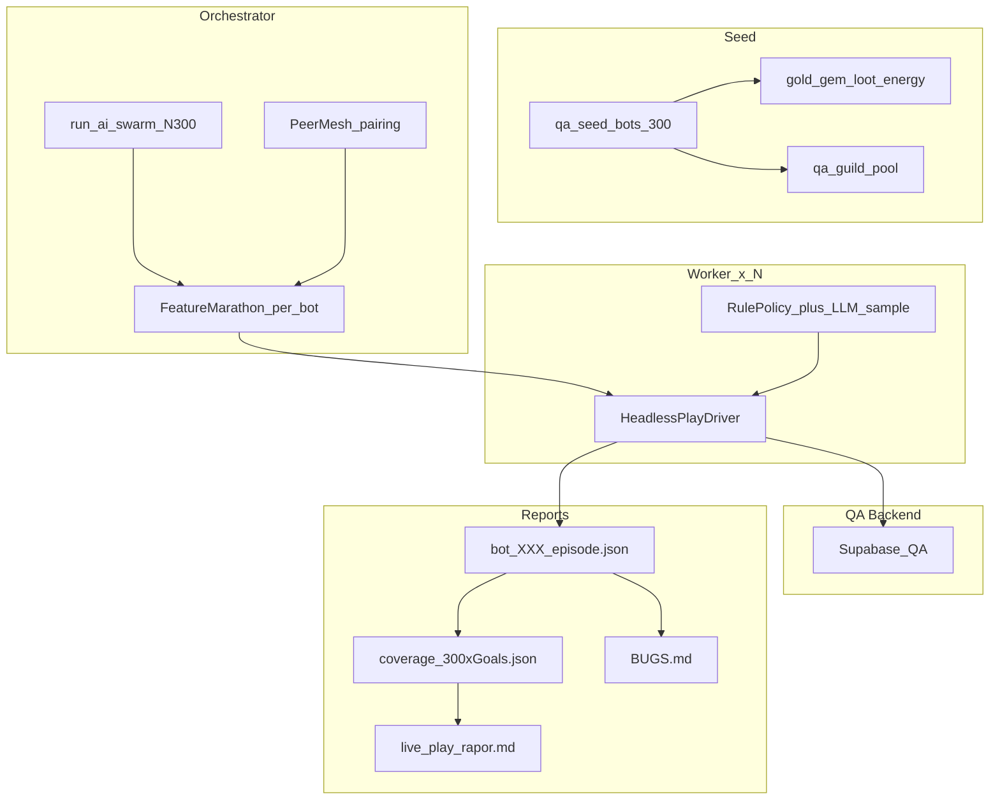

# AI Live-Play — 300 Bot × Tam Oyun Marathon

## Karar (kilit) — kullanıcı net

- **Kapsam:** Oyuncu yapabilir listesindeki **her aksiyon** → **her bot** yapar (300×).
- **Ortam:** Oyun henüz çıkmadı. **Gerçek oyuncu yok.** QA DB **launch öncesi sıfırlanacak** → yıkıcı / ekonomi kirletme OK.
- **Safety:** Production korkusu yok. Default **ALLOW ALL** (PvP, guild war, gem sink, market, leave guild, chat spam rate soft-cap sadece rate-limit için). Gerçek App Store IAP hâlâ stub → elmas = `qa_seed` / staff grant / `buy_gold_with_gems` / shop soft path.
- **Ölçek yolu:** **300 Flutter emulator YOK.** 300 = headless process/worker (`ProviderContainer` + repo/RPC veya DB-side bot driver). UI agent sadece spot-check (1–3).
- **LLM:** Pluggable (Ollama default). 300× her step LLM pahalı → **rule_policy primary**, LLM stuck/edge veya %sample (örn. her 10. bot).

---

## Hedef formülü

```
coverage_cell = (bot_i, feature_goal_j)
PASS iff bot_i feature_goal_j başarıyla koştu

Başarı = Σ PASS / (300 × |FeatureGoalRegistry|)
SKIP sadece gerçek precondition imkansız (örn. staff-only bot değilse staff goals)
```

**Zorunlu:** Listedeki her domain (auth hariç seed’de skip edilebilir login) her bot’ta en az 1 başarılı exec.

---

## Mimari (300 bot)



### Paralellik

| Katman | Nasıl |
|--------|------|
| Worker pool | `scripts/run_ai_swarm.sh --bots=300 --workers=20` (20 paralel process, queue) |
| Per bot | Sequential FeatureGoal marathon (~100–150 goals) |
| Peer mesh | Bot `i` ↔ `i+1` (DM/trade/market); lonca = 300/10 = 30 lonca × 10 üye |
| UI spot | Swarm bitince 1 device random bot replay fail goals |

**Isolate notu:** Flutter binding tek isolate. 300 = **OS process** veya **Python/Dart CLI headless** (UI yok), Flutter `integration_test` sadece spot.

---

## Seed (zorunlu ilk adım)

Yeni SQL/RPC: `qa_seed_bots(p_count int default 300)` (+ script)

Her bot için:

- Auth user + `users` row (`qa_bot_001` … `qa_bot_300`)
- Gold / gems / energy / HP yüksek seed
- Starter inventory (upgrade’lenebilir silah, scroll, craft mat, market’e konacak junk)
- Level/power zindan+PvP+GW için yeterli
- Lonca: 30 QA lonca, her biri 10 bot; lider = `…01` of group
- Monument/vault seed küçük bakiye
- Guild war season açık (QA flag) — attack mümkün
- Night market window QA force-open (opsiyonel)
- Staff bot **yok** (staff goals sadece `AI_INCLUDE_STAFF` ayrı 1 hesap)

Wipe: launch öncesi `qa_wipe_bots()` veya full DB reset (ayrı checklist).

---

## FeatureGoalRegistry = oyuncu listesi 1:1

Kaynak: konuşmadaki tam yapabilir listesi. Domain’ler:

1. Karakter / Kodex / stats  
2. Envanter / loot / potion / sell  
3. Zindan enter/attack/reward  
4. Kuşatma claim/challenge/release/hold  
5. PvP invite/accept/history/tournament/nemesis  
6. Lonca create/join/leave/promote/kick (rol uygun)  
7. Anıt donate/upgrade  
8. Vault deposit/collect/distribute (lider)  
9. Lonca savaşı attack/garrison/logs/election vote  
10. Pazar browse/search/list/buy/cancel  
11. Mağaza / gece pazarı / gem→gold  
12. Battle Pass claim (+ VIP QA grant sonrası)  
13. Görev complete/claim  
14. Banka deposit/withdraw/expand  
15. Trade initiate/confirm (peer)  
16. Craft start/claim/expand  
17. Enhancement forge + **equip upgraded**  
18. Tesis unlock/produce/collect/bribe  
19. Mekan create/stock/arena/bet  
20. At yarışı bet  
21. Hastane heal / hapishane bail-escape (seed ile zorla durum)  
22. İtibar shop  
23. Sıralama view/search  
24. Arkadaş request/accept  
25. Chat global/guild/trade + **DM pair**  
26. Bildirim oku  
27. Daily reward / settings toggle (logout hariç marathon sonu opsiyonel)

**Her bot** bu goal’leri koşar. Peer gerektirenler mesh ile.

Staff domain: 300’e dahil **değil** (ayrı opsiyonel).

---

## Safety (pre-launch QA)

| Eski kural | Yeni |
|------------|------|
| Gem spend deny | **ALLOW** (seed gems) |
| PvP deny | **ALLOW** |
| Guild war deny | **ALLOW** |
| Leave guild deny | **ALLOW** (marathon sonra re-join seed) |
| Real IAP | Stub — seed gems |
| Production players | **Yok** |
| DB wipe | Launch öncesi **zorunlu** |

Rate limit: chat flood → soft sleep (backend ban riski QA’de de var; throttle).

---

## Multi-bot mesh (sosyal)

```
pair(i) = bot_i  ↔  bot_(i % 300) + 1
guild(g) = bots[g*10 .. g*10+9]

Her bot:
  friends_send/accept with pair
  chat_dm_send / reply
  market_list_item → pair buys
  trade_initiate/confirm with pair
  guild_war_attack as guild member
  monument_donate
```

---

## Raporlar

`reports/ai_swarm_300_<timestamp>/`

| Dosya | İçerik |
|-------|--------|
| `bots/bot_XXX/episode.json` | per-bot step log |
| `coverage_matrix.json` | 300 × goals sparse/dense summary |
| `coverage_by_goal.md` | goal → pass_count/300 |
| `coverage_by_bot.md` | bot → % |
| `social_mesh.json` | pair/guild outcomes |
| `summary.json` | overall %, top failures |
| `BUGS.md` + `bugs.jsonl` | unique bugs dedupe |
| `live_play_rapor.md` | insan özet (crush rapor tarzı) |
| `WIPE_CHECKLIST.md` | launch öncesi silinecekler |

**Başarı kapısı:** `coverage_by_goal` her goal ≥ **280/300** PASS (≈%93) veya gerekçeli SKIP &lt; %7.

---

## Dosya planı

1. `supabase/migrations/..._qa_seed_bots_300.sql` — seed + wipe RPC  
2. `scripts/qa_seed_bots.sh` / `scripts/qa_wipe_bots.sh`  
3. `integration_test/agent/feature_goal_registry.dart` — tam liste  
4. `integration_test/agent/headless_play_driver.dart` — UI’siz marathon  
5. `integration_test/agent/peer_mesh.dart` — pairing  
6. `integration_test/agent/rule_policy.dart` + optional `llm_client.dart`  
7. `integration_test/agent/report_writer.dart` — 300 aggregator  
8. `scripts/run_ai_swarm.sh --bots=300 --workers=20`  
9. `scripts/run_ai_ui_spotcheck.sh` — 1 device  
10. `test/smoke/ai_swarm_coverage_test.dart` — summary assert gate  

Dart/env:

- `AI_BOTS=300`, `AI_WORKER_INDEX`, `AI_WORKERS=20`
- `AI_GOAL=all`
- `AI_ALLOW_ALL=true` (pre-launch)
- `AI_LLM_SAMPLE_RATE=0.05` (opsiyonel)
- `QA_ACCOUNTS` veya seed’den email pattern `qa_bot_{i}@gkk.test`

---

## Fazlar

### Faz 0 — Seed 300
RPC + script. Doğrula: 300 user login RPC ok.

### Faz 1 — Registry + 1 bot full marathon
1 bot headless → tüm goals. Kanıt episode + coverage % .

### Faz 2 — Mesh + 10 bot
Pair DM/market/trade. Lonca 1×10.

### Faz 3 — Scale 300
Worker pool 20. Aggregator. Fail triage.

### Faz 4 — UI spot-check
Fail eden goal’ler device’ta 1–3 bot.

### Faz 5 — Wipe ready
`qa_wipe_bots` + WIPE_CHECKLIST. Launch DB clean.

---

## Bilinçli redler

- 300 emulator / Appium farm  
- Production DB’de koşma (sadece QA/staging disposable)  
- Gerçek IAP billing  
- Staff ban/GM destructive’i 300 bota yayma  

---

## Not

Bu koşu **veriyi kirletir** (bilerek). Launch = wipe. Raporlar `reports/` arşiv kalır; DB bot satırları gitmez.
