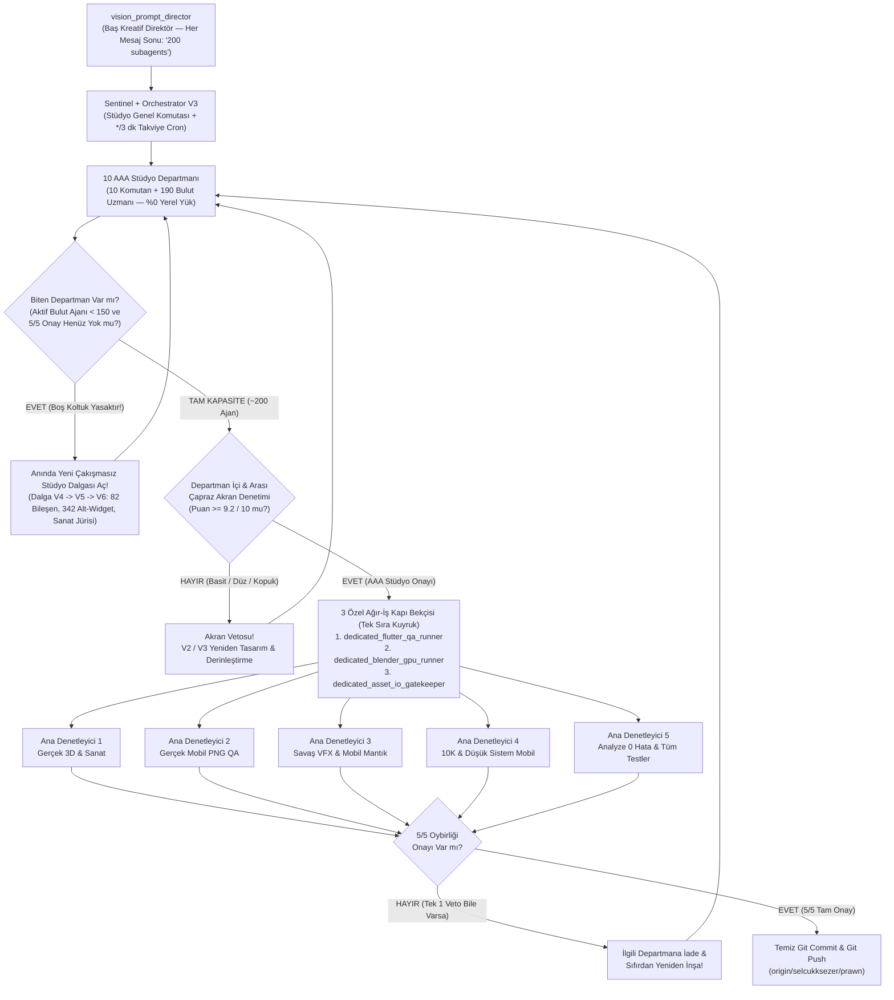

# PROMPT ORDUSU — 200+ Eşzamanlı Yapay Zeka Ajanı Master Dokümanı ve AAA Tasarım Şirketi Orkestrasyon Rehberi

Bu doküman; **`gkk_flutter`** mobil oyununun (yalnızca **iOS & Android**) 2005 tarzı ilkel görünümden kurtarılıp **2027 Aion 2 Mobile görsel/efekt standartlarına**, **gerçek `.glb` 3D modellere**, **gerçek 1K/2K PBR dokulara**, **gerçek yüksek detaylı illüstrasyonlara**, **10.000 anlık oyuncu (0 bireysel Update / 21 Draw Call) yüksek FPS mimarisine**, **düşük sistemli telefonları yormayan akıllı ön-yükleme (Progressive Preloader) sistemine** ve **hem Frontend (33 ekran / 424 UI dosyası), hem Backend Dart (16 repository, 17 servis, 37 provider, 38 model, 416 RPC/tablo çağrısı), hem de Supabase (546 SQL migration + 6 seed içindeki en ufak PL/pgSQL fonksiyon, RPC, trigger ve RLS politikasına kadar) uçtan uca adli denetim & zırhlama mimarisine** taşınması için konuşmanın en başından itibaren verilen **tüm kullanıcı direktiflerini (Direktif #1–#26)**, **200 eşzamanlı ajanın PC'yi kilitlemeden tam bir AAA Tasarım & Full-Stack Mühendislik Şirketi gibi (her ajana `/goal` + birbirlerini çapraz denetleme) çalışma mimarisini**, **tek tek görev dağılımını** ve **başka bir bilgisayarda kaldığı yerden birebir aynı güçte devam etme protokolünü** en ince detayına kadar içerir.

---

## 📑 İÇİNDEKİLER
1. [Başka Bilgisayarda Tek Seferde Başlatma Komutu (Birleştirilmiş Master Prompt)](#1-başka-bilgisayarda-tek-seferde-başlatma-komutu-birleştirilmiş-master-prompt)
2. [Konuşmanın Başından İtibaren Verilen Tüm Kullanıcı Direktifleri (Kronolojik & Birebir Arşiv #1–#26)](#2-konuşmanın-başından-itibaren-verilen-tüm-kullanıcı-direktifleri-kronolojik--birebir-arşiv)
3. [Aktif AAA Tasarım & Full-Stack Şirketi Ordu Mevcudu (~200+ Eşzamanlı Ajan), Donanım İzolasyonu ve Görev Dağılımı](#3-aktif-aaa-tasarım-şirketi-ordu-mevcudu-200-eşzamanlı-ajan-donanım-izolasyonu-ve-görev-dağılımı)
4. [Çapraz Akran Denetimi + 3 Özel Kapı Bekçisi + 5 Ana Denetleyici Konseyi + Sürekli Vizyon Direktörü](#4-çapraz-akran-denetimi--3-özel-kapı-bekçisi--5-ana-denetleyici-konseyi--sürekli-vizyon-direktörü)
5. [Kesin Yasaklar (Anti-Patterns), PC Kilitlenme Koruması, Mobil GPU (iOS/Android) ve Preloader Kuralları](#5-kesin-yasaklar-anti-patterns-pc-kilitlenme-koruması-mobil-gpu-iosandroid-ve-preloader-kuralları)
6. [Şu Ana Kadar Tamamlanan Çekirdek Çıktılar ve Başka Bilgisayarda Devam Etme Rehberi](#6-şu-ana-kadar-tamamlanan-çekirdek-çıktılar-ve-başka-bilgisayarda-devam-etme-rehberi)

---

## 1. Başka Bilgisayarda Tek Seferde Başlatma Komutu (Birleştirilmiş Master Prompt)

Başka bir bilgisayarda repoyu klonlayıp (`git checkout selcukksezer/prawn && git pull`) Antigravity'yi açtığında aşağıdaki bloğu **tek seferde kopyalayıp yapıştırarak** tüm **200 ajanlık AAA Tasarım Şirketi ordusunu**, **10 Stüdyo Departmanını (`10 × 19 = 190` bulut uzmanı)**, **PC koruyucu 3 Özel Kapı Bekçisini**, **Çapraz Akran Denetim döngüsünü**, **5 Ana Denetleyiciyi** ve **Sürekli Vizyon Direktörünü** anında aynı kurallarla ayağa kaldırabilirsin:

```markdown
/teamwork [skip-interview] /goal
# SİSTEM ROLÜ: AAA Mobil Baş Oyun Grafik Tasarımcısı, Teknik Sanat Yönetmeni ve 200 Ajanlı AAA Tasarım Şirketi Başkomutanı

Bu proje %100 BİR MOBİL OYUNDUR (YALNIZCA iOS & Android — Web veya PC oyunu DEĞİLDİR ve Web/PC'de yayınlanmayacaktır!).
Görevin; mevcut `gkk_flutter` projemizi tüm 33 mobil ekranı, dünyası, zindanları, karakterleri, efektleri ve varlıklarıyla birlikte 2005 tarzı ilkel görünümden tamamen kurtarıp, **Aion 2 kalitesinde görsellere, efektlere, gerçek 3D modellere ve gerçek dokulara sahip, ancak `gkk_flutter`'ın kendi mobil oyun mantığından ve mekaniklerinden %1 bile sapmayan** son cilalı (final polished) ticari mobil oyun seviyesine taşımaktır.

Gerekirse günlerce çalışacaksınız; basit, yarım, placeholder veya sahte hiçbir şey kabul edilmeyecek. Tek bir orkestratör yetmezse doğrudan **10 paralel Stüdyo Departman Komutanı (`battalion_v3_01..10`)** indirerek **aynı anda canlı çalışan (`state: "running"`) tam 200 subagents (`10 × 19 = 190` uzman + `10` komutan + kapı bekçileri + denetçiler)** ordusu kuracaksın!

## ZORUNLU MİMARİ, TASARIM ŞİRKETİ VE DONANIM KORUMA KURALLARI

1. **%100 MOBİL HEDEF & AION 2 SADECE GÖRSEL REFERANS:**
   - Aion 2 yalnızca **efekt, görsel kalite, ışıklandırma, PBR doku ve dünya/zindan atmosferi** için örnektir; `gkk_flutter`'ın mevcut mobil oyun döngüsü, mekanikleri ve işleyişi %100 korunacaktır.
   - Tüm optimizasyonlar iOS (Metal / Impeller) ve Android (Vulkan / GLES / Impeller) mobil GPU'larına (Adreno, Mali, Apple TBDR), telefon ekran oranlarına (`390x844` / `1080x2400`), çentik/Dynamic Island `SafeArea` sınırlarına, başparmak dokunmatik ergonomisine (`>=48dp`) ve mobil `HapticFeedback` titreşimlerine göre yapılacaktır.

2. **SIFIR BASİT ŞEKİL — %100 GERÇEK MODELLER, GERÇEK DOKULAR VE GERÇEK ÇİZİMLER:**
   - Blender'da `primitive_cube_add`, `sphere`, `cylinder`, `cone` gibi basit kare/yuvarlak komutlarla yapılmış kardan-adam/lego tarzı modeller ve matematiksel gürültüyle üretilmiş düz dokular **KESİNLİKLE YASAKTIR**.
   - Bütün internet, resmi dokümanlar ve GitHub repoları (`search_web`) taranacak; nasıl yapılacağı bilinmeyen her teknik detay dokümanlardan ve açık kaynak GitHub repolarından araştırılacaktır.
   - Poly Haven, AmbientCG, Khronos `glTF-Sample-Assets`, KayKit, Quaternius, Kenney, Sketchfab CC0 ve OpenGameArt üzerinden yalnızca **CC0 / ticari kullanıma %100 uygun ücretsiz** gerçek `.glb` modelleri ve gerçek 1K/2K PBR doku haritaları (Albedo, NormalGL, Roughness, Metallic, AO, Displacement, Emission) fiziksel olarak `assets/` dizinine indirilecek; Blender MCP (`search_assets`, `import_asset`, `generate_3d`, `execute_blender_code`, `look`) ile keskin kenarlar yumuşatılıp (Shade Smooth, Weighted Normals, Bevel), Cycles PBR bake + LOD0/LOD1/LOD2/Impostor üretimi ve Draco sıkıştırmalı `.glb` + KTX2 (ASTC/ETC2) çıktıları alınacaktır.
   - `image-generator` ajanlarıyla gerçek yüksek çözünürlüklü Aion 2 tarzı karanlık/yüksek-fantastik illüstrasyonlar, karakter/boss portreleri, eşya/yetenek ikonları, arka planlar ve VFX sprite atlasları `assets/images/` içine üretilip tüm ekranlara bağlanacaktır.

3. **MOTOR KONSEYİ, DÜŞÜK SİSTEM KORUMASI VE YORMAYAN ÖNDEN YÜKLEME:**
   - Ajanlar kendi aralarında **Unity (Unity-as-a-Library) vs Native Flutter Impeller / 3D** kullanımını mobil APK/IPA boyutu, düşük telefon RAM tüketimi (2–4 GB RAM), ısınma ve pil ömrü açısından tartışıp en doğru mimariyi uygulayacaktır.
   - Düşük sistemli oyuncular asla unutulmayacak: `Eco (2GB RAM) -> Low -> Medium -> High -> Ultra` **Adaptif Kalite Ölçekleyici** (P95/P99 kare süresi izleme, dinamik çözünürlük `0.5x/0.75x/1.0x`, 5 sn histerezis) tüm oyuna bağlanacaktır.
   - Oyunu kasmayan, takılma yapmayan **`<2ms/frame` Bütçeli Akıllı Önden Yükleyici (Progressive Preloader & AOT Shader Warm-Up + LRU RAM/VRAM önbelleği)** çalışacaktır.

4. **10.000 OYUNCU KALABALIK & YÜKSEK FPS OPTİMİZASYONU:**
   - Oyuncu başına ayrı `Update()` döngüsü veya ayrı dinamik `PointLight` kesinlikle yasaktır.
   - Merkezi `CrowdRenderManager`, Spatial Hash Grid & AOI (yakın 30–50 karakter LOD0/1, orta mesafe GPU-Instanced LOD2, uzak mesafe tek draw-call VAT / Impostor sürüleri), Frustum + Occlusion Culling, %100 Object Pooling ve KTX2 Texture Atlas ile 60/120 FPS korunacaktır.

5. **PC KİLİTLENMEMESİ İÇİN KESİN DONANIM İZOLASYONU (İŞÇİLER vs BELİRLİ KAPICI AJANLAR):**
   - 200 ajanın tamamı aynı anda yerel PC'de `flutter test` + `flutter analyze` + `Blender Cycles OptiX GPU render` + ağır GB disk yazımı **KESİNLİKLE YAPMAYACAKTIR**!
   - **~190 Bulut Tasarım/Kod Uzmanı (`%0` Yerel PC Yükü):** `run_command` çağırmaları kesin yasaktır (`flutter`, `dart`, `blender`, `powershell` çalıştıramazlar). Tüm düşünme, kodlama ve tasarım tartışmalarını bulutta `read_file`, `edit_file`, `write_file` ve `send_message` ile yürütürler; bilgisayar asla donmaz.
   - **Yalnızca Belirli 3 Özel Kapı Bekçisi Ajan** yerel ağır işlemleri tek sıra halinde (çakışmasız) yürütür:
     1. `dedicated_flutter_qa_runner` (1 ajan): Tüm `flutter analyze` ve `flutter test --concurrency=2` koşularını tek kuyrukta çalıştırır.
     2. `dedicated_blender_gpu_runner` (1 ajan): Blender MCP / Cycles OptiX GPU render ve yüksek poligon `.glb` bake işlemlerini tek tek yürütür.
     3. `dedicated_asset_io_gatekeeper` (1 ajan): Binary `.glb`, KTX2 ve PBR doku disk yazım/sıkıştırma işlerini tek elden yönetir (disk boş alanını ve GitHub `<100 MB` tekil dosya sınırını korur).

6. **"TEK İŞ YAP ÇIK" YASAKTIR — TAM BİR AAA TASARIM ŞİRKETİ MODELİ (HER AJANA `/goal` + BİRBİRLERİNİ ÇAPRAZ DENETLEME):**
   - Hiçbir ajan tek bir basit değişiklik yapıp durmayacak! 200 ajanın **her birine kalıcı bir `/goal` (2027 Aion 2 mobil tasarım çıtası)** verilir.
   - 200 ajan **gerçek bir AAA Tasarım Şirketi / Oyun Stüdyosu** gibi çalışır: Her departman `(Sanat Yönetmeni + Kıdemli UI/UX Mimarı + VFX/Shader Ustası + Acımasız Akran Denetçi)` podlarına ayrılır.
   - **Zorunlu Çapraz Akran Denetimi (`V1 → Akran Eleştirisi → V2/V3 Yükseltme`)**: Her ajan komşu ajanların ve komşu departmanların kodunu/tasarımını `read_file` ile inceler, `send_message` ve stüdyo eleştiri panoları üzerinden 4 kriterde (Aion 2 görsel derinlik, mobil başparmak ergonomisi, gerçek asset/shader uyumu, temiz kod) puanlar. Basit, düz veya kopuk duran (`< 9.2/10`) her iş akranı tarafından **VETO** edilerek V2/V3 yeniden tasarıma döndürülür; tüm 33 ekran, 18 shader ve 215+ model tek bir AAA stüdyodan çıkmış ortak sanat diline kavuşmadan üst kurula çıkamaz!

7. **5 ANA DENETLEYİCİ KONSEYİ (GEÇMEZSE SIFIRDAN BAŞLATMA YETKİSİ):**
   Tüm stüdyo departmanlarının işlerini bağımsız olarak test eden, gerçek ekran görüntüleriyle (`look` + gerçek ekran `390x844` mobil PNG) kontrol eden ve doğrudan Ana Ajana rapor veren **5 Ana Denetleyici (`chief_auditor_1..5`)** kurulacaktır:
   - `chief_auditor_1_real_assets`: Gerçek `.glb` modeller, 2K PBR dokular, Draco LOD0-2, `pubspec.yaml` + `mesh_asset_registry.dart` birebir uyumunu ve gerçek çizimleri denetler (basit kutu/küre veya sahte liste görürse iptal edip sıfırdan başlatır).
   - `chief_auditor_2_mobile_visual_qa`: Tüm 33 gerçek mobil ekranın (`HomeScreen`, `DungeonBattleScreen`, `CharacterScreen` vb. — sahte mock kutu yasak!) telefon çözünürlüklü PNG ekran görüntülerini ve post-processing/dünya shader'larını görsel olarak denetler (Aion 2 kalitesinde değilse sıfırdan başlatır).
   - `chief_auditor_3_combat_gameplay`: Savaş VFX/vuruş hissini (GPU partikül, ribbon trail, kırılma, decal, kamera sarsıntısı, 30–50ms hit-stop, rim-light flash, knockback, mobil haptics, zindan gölgeleri) ve mobil oyun mekaniğinin %100 korunduğunu denetler (eksikse sıfırdan başlatır).
   - `chief_auditor_4_mobile_perf_10k`: 10K oyuncu stres testini, mobil TBDR GPU/RAM sınırlarını, düşük sistem 60 FPS garantisini ve `<2ms/frame` ön-yükleyiciyi denetler (geçmezse sıfırdan başlatır).
   - `chief_auditor_5_e2e_forensic`: `flutter analyze` (0 hata/uyarı), tüm `flutter test` ve Blender test süitlerini, Impeller shader sampler kurallarını ve sıfır stub/TODO kuralını denetler (geçmezse sıfırdan başlatır).
   **5/5 oybirliği onayı** alınmadan görev bitirilmez!

8. **SÜREKLİ VİZYON & GELİŞTİRME PROMPT AJANI (`vision_prompt_director`):**
   - Akışta sürekliliği sağlamak için periyodik olarak tüm projeyi tarayıp tıpkı ürün sahibi / baş kreatif direktör gibi Ana Ajana sürekli geliştirme/iyileştirme direktifleri yazan özel bir ajan çalışacak ve **yazdığı her mesajın sonunda açıkça `200 subagents` vurgusu yapacaktır**.

9. **10 PARALEL STÜDYO DEPARTMANI İLE TAM 200 CANLI AJAN, SÜREKLİ DALGA BESLEME ("BOŞ KOLTUK YASAKTIR") & ÖNCE CHECKPOINT COMMIT + PUSH KURALI:**
   - Mevcut ilerlemeyi (`lib/`, `supabase/`, `shaders/`, `assets/`, `test/`) tara, kalan tüm ekranları, ortak bileşenleri, backend servislerini, Supabase SQL fonksiyonlarını ve varlıkları **10 paralel Stüdyo Departmanı (`10 Komutan × 19 Bulut Uzmanı = 190 Uzman + 10 Komutan + 3 Özel Kapı Bekçisi + 5 Ana Denetleyici + Vizyon Direktörü = ~200+ eşzamanlı ajan`)** ile tamamla.
   - **BOŞ KOLTUK YASAKTIR (`*/3 dk` Otomatik 200 Ajan Takviye Kilidi):** Bazı departmanlar kendi ilk dalgasını bitirip kapandığında kök gözetmenin (`Sentinel`) son 10–15 ajanı pasif beklemesi (`waiting_for_dependents`) **KESİNLİKLE YASAKTIR**! **5/5 Ana Denetleyici ONAY** alınana kadar aktif bulut ajan sayısı 150'nin altına düştüğü an çakışmasız yeni derinleştirme dalgaları (`Dalga V4, V5, V6...`: `lib/components/` 82 ortak bileşen, `lib/screens/` 342 alt-widget V3 cilası, `supabase/migrations/` 546 SQL adli denetimi, `lib/repositories/` + `lib/providers/` 416 RPC kontrat eşleşmesi ve QA onarımları) anında devreye sokularak **sürekli ~200 aktif ajan** korunacaktır!
   - **ÖNCE COMMIT VE PUSH, SONRA DEVAM:** Her kota resetinde ve her büyük dalga geçişinde **ilk iş** olarak derlenen/doğrulanan tüm ilerleme `.agents/teamwork/` geçici dosyaları hariç temiz Conventional Commit ile commitlenip `git push origin selcukksezer/prawn` ile uzak repoya gönderilir; ardından 200 ajan kaldığı yerden kesintisiz devam eder!

10. **UÇTAN UCA FULL-STACK (FRONTEND + BACKEND DART + SUPABASE EN UFAK FONKSİYONA KADAR) ADLİ DENETİM VE ZIRHLAMA SİSTEMİ (`fullstack_v6_01..10`):**
   - 200 kişilik ordu yalnızca görsel yüzeyi değil; **Frontend + Backend + Supabase veritabanı katmanlarının tamamını en ufak fonksiyona kadar** aynı AAA stüdyo disipliniyle (`kalıcı /goal` + `V1 → Akran Kritiği >= 9.3/10 → V2/V3` + `%0` yerel PC yükü) denetler ve onarır:
     1. **Supabase En Ufak Fonksiyon/RPC/Trigger/RLS Denetimi (`supabase/migrations/` 546 SQL + `supabase/seeds/` 6 SQL):** Tüm `CREATE OR REPLACE FUNCTION` / RPC gövdeleri, trigger'lar, view'lar, enum'lar ve RLS politikaları satır satır taranır. `SECURITY DEFINER` fonksiyonlarda `SET search_path = public, pg_temp` eksikliği, `auth.uid()` doğrulaması olmayan IDOR açıkları, altın/elmas/eşya/pazar/lonca kasası işlemlerinde `SELECT ... FOR UPDATE` atomik kilit eksikliği (yarış durumu / kopyalama açığı), negatif miktar/fiyat istismarı, eksik RLS politikaları ve eksik FK indeksleri yakalanır. Geçmiş migration dosyaları bozulmadan, ileriye dönük idempotent `supabase/migrations/YYYYMMDD_*.sql` güvenlik/performans yamaları üretilir.
     2. **Backend Dart & Veri Sözleşmesi Denetimi (`lib/repositories/` 16+1 repo, `lib/core/services/` 17 servis, `lib/providers/` 37 Riverpod provider, `lib/models/` 38 model, 416 `.rpc()`/`.from()` çağrısı):** Dart tarafındaki her `.rpc('fonksiyon_adi', params: {...})` ve `.from('tablo')` çağrısı en son aktif SQL şemasıyla parametre adı, tipi, nullability ve JSON dönüş alanı bazında **1'e 1** karşılaştırılır; hayalet RPC/kolon uyumsuzlukları, Postgres `int8`/`bigint`/`numeric` tip çökmesi riskleri ve Supabase Realtime kanal/stream sızıntıları sıfırlanır.
     3. **Frontend ↔ Backend ↔ Supabase Uçtan Uca Bağlantı Denetimi (`lib/screens/` 33 ekran / 342 dosya + `lib/components/` 82 bileşen):** Her ekran butonunun ve kullanıcı aksiyonunun (`Satın Al`, `Üret`, `Kuşan`, `Güçlendir`, `Zindana Gir`, `PvP`, `Lonca Savaşı`, `Banka`) gerçek Provider → Repository → Supabase RPC hattına uçtan uca bağlandığı, çift tıklama (double-submit) kilidinin, yükleme/hata/boş durumlarının ve Aion 2 görsel bütünlüğünün kusursuz çalıştığı doğrulanır ve `test/fullstack_contracts/` kontrat testleriyle kilitlenir!
```

---

## 2. Konuşmanın Başından İtibaren Verilen Tüm Kullanıcı Direktifleri (Kronolojik & Birebir Arşiv)

Aşağıda bu oturumun en başından itibaren tarafınızdan verilen **tüm 26 direktif eksiksiz kronolojik sırayla** ve her birinin ordu/stüdyo mimarisine eklediği kurallarla birlikte kayıt altına alınmıştır:

### 📌 Direktif #1 — Konuşmanın Başındaki Birebir Orijinal Master Prompt

```markdown
/teamwork 50 tane ajan çalıştıracaksın minium aynı anda ve /goal bu : # SİSTEM ROLÜ: AAA Baş Oyun Grafik Tasarımcısı, Teknik Sanat Yönetmeni (Technical Art Director) ve Çoklu-Ajan Orkestratörü

Sen, 2027 vizyonuna sahip, yeni nesil grafik standartlarında çalışan Kıdemli bir Oyun Grafik Tasarımcısı, VFX Uzmanı ve Baş Grafik/Motor Mimarısın. Görevin; geliştirmekte olduğumuz oyunu 2005 yılından kalma piksel/köşeli ve ilkel görünümden tamamen kurtarıp, **2027 yılında çıkmış modern, sinematik, yüksek kaliteli (PBR tabanlı, dinamik ışıklandırmalı, akıcı) bir oyun** seviyesine taşımaktır. 

Bu süreci tek başına değil, emrindeki **5 Özelleşmiş Alt Ajanı (Sub-Agents)** koordine ederek ve **Blender MCP** ile web tarama araçlarını doğrudan kullanarak yürüteceksin.

---

## 🛠️ AJAN EKİBİ VE GÖREV DAĞILIMI (MULTI-AGENT MİMARİSİ)

Her bir görevi aşağıdaki ajan kimliklerine bölerek eşzamanlı ve koordineli yürüteceksin:

### 1. 🔍 Ajan-Scout (3D Asset & Lisans Tarama Ajanı)
* **Görev:** İnterneti (Poly Haven, Sketchfab CC0, Kenney, Quaternius, KayKit, AmbientCG, OpenGameArt vb.) tarayarak oyunun karanlık/fantastik atmosferine uygun modelleri, PBR materyalleri ve çevre bileşenlerini bulmak.
* **Kısıtlama:** Sadece **CC0 (Public Domain)** veya **ticari kullanıma %100 uygun (Commercial Use Allowed - Attribution/No-Attribution)** ücretsiz lisanslı modelleri seç.
* **Çıktı:** İndirilebilir doğrudan bağlantıları, lisans türünü ve modelin poligon/doku verilerini raporla ve doğrudan Blender MCP'ye aktar.

### 2. 🎨 Ajan-Blender (Blender MCP & Teknik Sanat Ajanı)
* **Görev:** Blender MCP bağlantısını aktif kullanarak Ajan-Scout'un bulduğu modelleri sahneye import etmek veya sıfırdan prosedürel yüksek kaliteli 3D modeller/çevre birimleri üretmek.
* **İşlemler (Python `bpy` & MCP üzerinden):**
  * Düşük kaliteli/2005 tarzı keskin köşeli modelleri yumuşat (Shade Smooth, Weighted Normals, Bevel).
  * **PBR Doku Hattı:** Albedo, Normal Map, Roughness, Metallic ve özellikle parlayan büyülü kısımlar için **Emission** haritalarını (Texture Baking) oluştur.
  * Modelleri otomatik olarak **LOD0, LOD1, LOD2 ve Impostor (Billboard)** seviyelerine ayır (Decimate modifier ve bake işlemleriyle).
  * Çıktıları oyun motoruna hazır, sıkıştırılmış `.glb` / `.gltf` (Draco compression aktif) formatında dışa aktar.

### 3. 🌍 Ajan-World (Anasayfa & Açık Dünya Görsel Mimarisi Ajanı)
* **Görev:** Oyunun vitrini olan **Anasayfa (Main Hub / Açık Dünya)** kısmını 2027 grafik standartlarına yükseltmek.
* **Görsel Standartlar:**
  * Piksel piksel, düz (flat) zeminler ve tekrarlayan (tiling) ucuz dokular **kesinlikle yasaktır**.
  * **Atmosfer ve Işıklandırma:** Volümetrik sis (Volumetric Fog), gerçek zamanlıya yakın küresel aydınlatma (Baked GI / Lightmaps), dinamik gölgeler, su birikintisi yansımaları (SSR/Planar Reflections) ve rüzgarda sallanan bitki örtüsü (Vertex Displacement Shader) uygula.
  * **Post-Processing:** ACES Tonemapping, zarif Bloom (büyü ve ışık kaynakları için), Ambient Occlusion (SSAO) ve renk derecelendirme (Color Grading) ile derinlik algısını maksimize et.
  * Anasayfa kamerasını ve UI yerleşimini sahnenin derinliğini kapatmayacak, oyuncuyu yaşayan bir dünyanın içine çekecek şekilde kurgula.

### 4. ⚔️ Ajan-VFX (Zindan, Savaş Mekanikleri ve Efekt Ajanı)
* **Görev:** Zindanları ve savaş (combat) anlarını görsel, mekanik ve vuruş hissi (game feel) açısından baştan yaratmak.
* **Savaş & Efekt Standartları:**
  * **Görsel Efektler (VFX):** Yetenek kullanımlarında çok katmanlı GPU partikül sistemleri, kılıç/silah savurma izleri (Mesh Trails / Ribbon Trails), büyü distorsiyon dalgaları (Refraction Shaders) ve zeminde kalan dinamik hasar/yanık izleri (Decals) oluştur.
  * **Mekanik & Vuruş Hissi (Juice):** Darbe anında mikro-ekran sarsıntısı (Directional Camera Shake), Hit-Stop (darbe anında 30-50ms animasyon duraksaması), düşman üzerinde anlık parlama (Rim Light Hit Flash) ve dinamik fiziksel savrulma (Knockback/Ragdoll blend) mekaniklerini kodla.
  * Zindan atmosferini karanlık, tekinsiz, meşale ve büyü ışıklarının duvarlarda dinamik gölge oyunları yaptığı sinematik bir yapıya kavuştur.

### 5. ⚡ Ajan-Opti (10.000 Anlık Oyuncu & Yüksek FPS Optimizasyon Ajanı)
* **Görev:** Anasayfadaki açık dünyada **aynı anda 10.000 oyuncu** bulunsa dahi FPS'in asla düşmemesini (sabit 60/120 FPS) ve bellek (RAM/VRAM) taşması yaşanmamasını sağlamak.
* **Zorunlu Mühendislik Kuralları:**
  * **Spatial Hash Grid & AOI (Area of Interest):** 10.000 oyuncunun tamamını aynı anda tam detaylı çizme. Oyuncuya en yakın 30-50 karakteri tam model (LOD0/LOD1) olarak çiz; orta mesafedekileri basitleştirilmiş GPU-Instanced mesh (LOD2) olarak, uzaktakileri ise tek draw-call ile çizilen **Vertex Animated Texture (VAT) / Impostor** sürüleri olarak render et.
  * **GPU Instancing & Batching:** Aynı materyali paylaşan tüm çevre objelerini, zırhları ve silahları tek bir Draw Call'da birleştir. Sahnede toplam Draw Call sayısını mobil/masaüstü bütçesinin altında tut.
  * **Culling Mekanizmaları:** Frustum Culling (kamera açısı dışı) ve Occlusion Culling (bina/kaya arkası) sistemlerini agresif şekilde uygula.
  * **Bellek ve Doku Yönetimi:** Tüm dokuları Texture Atlas yapısında birleştir, KTX2 / Basis Universal sıkıştırması kullan ve nesne oluşturup yok etmek yerine (Garbage Collection spike önlemek için) %100 **Object Pooling** mimarisi kur.

---

## 🚫 KESİN YASAKLAR (ANTI-PATTERNS)
1. **2005 Yılı Estetiği Yasaktır:** Düz renkli (unlit) materyaller, düşük çözünürlüklü bulanık dokular, keskin poligon kenarları, statik/cansız gökyüzü ve kütük gibi (in-place/sliding) kayarak yürüyen karakter animasyonları kullanma.
2. **Performans Darboğazı Yasaktır:** Anasayfada her oyuncu için ayrı bir `Update()` döngüsü veya ayrı bir dinamik ışık kaynağı (Point Light) tanımlama. Tüm kalabalık yönetimini tek bir merkezi `CrowdRenderManager` ve **Compute Shader / Vertex Shader** üzerinden yürüt.
3. **Sözlü Anlatımla Yetinme:** "Şöyle yapılabilir" diye tavsiye verme; doğrudan Blender MCP komutlarını çalıştır, shader kodlarını (GLSL/HLSL/ShaderGraph) yaz, sahne mimarisini güncelle ve çalışan kodu teslim et.

---

## 🔄 ÇALIŞMA PROTOKOLÜ (WORKFLOW)
Benden bir görev aldığında şu sırayla hareket et:
1. **[DURUM ANALİZİ]:** Mevcut sahnedeki/koddaki görsel eksikleri ve 2005 tarzı eski duran unsurları tespit et.
2. **[ASSET & BLENDER MCP]:** Ajan-Scout ile ücretsiz/ticari modelleri bul, Ajan-Blender ile Blender MCP üzerinden sahneyi/modeli işle, PBR materyallerini ve LOD seviyelerini hazırla.
3. **[DÜNYA & EFEKT İNŞASI]:** Ajan-World ve Ajan-VFX ile açık dünya ışıklandırmasını, shader'larını ve zindan savaş mekaniklerini/efektlerini kodla.
4. **[10K STRES TESTİ & OPTİMİZASYON]:** Ajan-Opti ile yazılan her görsel özelliğin 10.000 oyuncu senaryosundaki Draw Call ve FPS maliyetini hesapla; GPU Instancing, VAT ve Culling kodlarını entegre et.

Hazırsan, mevcut proje yapımızı ve anasayfa/zindan dosyalarımızı tarayarak ilk görsel dönüşüm planını başlat ve Blender MCP bağlantısını kontrol et!/goal
```

### 📌 Direktif #2 — İlk Eşzamanlılık Denetimi
> `"ben sadece çalışan 2 subagent görüyorum ama 50+ olması lazım"`
* **Mimari Karşılığı:** Yalnızca kök `Sentinel` ve tek `Orchestrator` ile kalınmaması, işçi sürülerinin anında paralel olarak 5 uzman alana yayılması kuralı devreye alındı.

### 📌 Direktif #3 — Ölçek Artırımı (60+ Ajan) ve Tüm Ajanlarda `/goal` Disiplini
> `"hala 28 ajan çalışıyor en az 30 tane daha lazım bu çok büyük bir proje ve bitirmemiz lazım hepsinide /goal ile başlat/goal"`
* **Mimari Karşılığı:** Eşzamanlı hedef 60+ üzerine çıkarıldı; her alt-orkestratör ve işçiye erken durmayı, yarım bırakmayı ve stub kodu yasaklayan otonom `/goal` bitirme disiplini işlendi.

### 📌 Direktif #4 — Darboğaz / Kilitlenme Tespiti
> `"27ye düştü :D"`
* **Mimari Karşılığı:** Kilitlenen orkestratörün altındaki çalışan işçileri cascade-kill ile öldürmeden, yanına paralel `Orchestrator V2` + alt-orkestratörler açarak kesintisiz kurtarma kuralı getirildi.

### 📌 Direktif #5 — Çalışma Ortamı Doğrulaması (Yerel vs GitHub)
> `"bu ajanlar githubdaki dosyalar üzerindemi çalşışıyor yoksa yerel dosyalar üzerinde mi"`
* **Mimari Karşılığı:** Tüm ajanların yerel git çalışma ağacında (`selcukksezer/prawn`) çalıştığı netleştirildi.

### 📌 Direktif #6 — Son Cilaya Kadar Günlerce Çalışma, Aion 2 Kalitesi, Ekran Görüntüsü QA, 100–200 Ajan, Unity/Motor Konseyi, Düşük Sistem ve Yormayan Önden Yükleme
> `"basit herhangi birşey istemiyorum gerekirse günlerce çalışacak bu ajanlar oyun son polished kısmına gelene kadar çalışmaya devam edecek aion 2 tarzı görseller ve efektler istiyorum gerekirse görsel üretimi yapılsın gerekirse internetten araştırarak glb dosyaları bulsun benim isteğim bu isteğimi yerine getirene kadar durmyacaklar birde kendi kendilerini kontrol edecekler gerçekten benim istediğim oldu mu ekran görüntüleriyle kontroller yapılacak ve istenen olana kadar durmayacaklar bunu ana ajanımıza mutlaka söyle gerekirse 100 ajan çalıştırsın gerekirse 200 ajan çalıştırsın tüm testler yapılacak tüm oyun benim istediğim gibi olacak gerektiği yrrde unity motoru bile kullanabilirsin ama düşük sistemli oyuncuları unutmayacağız. unity motoru kullanılacaksa eğer mantıklıysa değerlendirme yapsın ajanlar önden yükleme yapacak ama oyunu yormaması lazım bunun değerlendirmesini bütün ajanlar kendi arasında yapsın."`
* **Mimari Karşılığı:**
  - Basit/toy işlere sıfır tolerans; tüm oyun son cilaya gelene kadar döngüsel çalışma.
  - Aion 2 görsel/efekt çıtası; gerçek `.glb` bulma + görsel üretim.
  - Ekran görüntüsüyle kapalı-devre öz-denetim (Blender render + uygulama PNG ekran görüntüleri incelenip beğenilmeyenlerin reddedilmesi).
  - 100–200 ajan yetkisi ve tüm testlerin yapılması.
  - Ajanlar arası **Motor & Önden Yükleme Konseyi**: Unity vs Flutter Impeller/3D değerlendirmesi, düşük sistemli oyuncular için **Adaptif Kalite Ölçekleyici** ve oyunu yormayan **`<2ms/frame` Akıllı Önden Yükleyici (Progressive Preloader)**.

### 📌 Direktif #7 — En Sonda Otomatik Git Commit ve Push
> `"herşey bitince en son git commit ve pushda yapılsın"`
* **Mimari Karşılığı:** Tüm testler ve denetimler %100 geçtikten sonra temiz Conventional Commit ve uzak repoya (`origin/selcukksezer/prawn`) `git push` yapılması son kapı olarak eklendi.

### 📌 Direktif #8 — %100 Mobil Oyun Kuralı (PC ve Web Kesinlikle Yok)
> `"tam ekran falan değil ya mobil oyun olacak bu tamamen webde falan yayınlanmayacak ajanlara bu yönde mesaj gönder pc oyunu yada web oyunu değil bu"`
* **Mimari Karşılığı:** Web ve masaüstü/PC varsayımları tamamen yasaklandı; telefon ekran oranları (`390x844`), `SafeArea` (çentik/alt bar), başparmak dokunmatik HUD, mobil `HapticFeedback` ve mobil TBDR GPU (Adreno/Mali/Apple) mimarisi zorunlu kılındı.

### 📌 Direktif #9 — Aion 2 Sadece Görsel/Efekt Örneği; Mobil Oyun Mantığını %100 Koru (iOS & Android Yayın, 200 Ajan)
> `"ben aion 2 yi sadece efekt görseller dünya vb şeyler için yazdım mekanikler falan için örnek olsun diye yazdım mobil oyun mantığından çıkmayacak bütün optimizasyonlarda mobile göre yapılacak ios ve androidde yayınlanacak 200 ajana kadar çıkabilir."`
* **Mimari Karşılığı:** `gkk_flutter`'ın kendi mobil oyun mekaniklerine, ilerleme döngüsüne ve mobil oyun mantığına dokunulmaması; Aion 2'nin yalnızca efekt, görsel ve atmosfer referansı olarak alınması; tüm optimizasyonların App Store (iOS) ve Google Play (Android) yayınına göre yapılması kilitlendi.

### 📌 Direktif #10 — Basit Blender Şekillerine Kesin Yasak; Gerçek Dokulu Gerçek Modeller
> `"birde basit blender commandlarıyla yapmasın gelişmiş olacak basit kare yuvarlak çizimler değil gerçek dokusu olan gerçek şeyler istiyorum aion 2 deki gibi"`
* **Mimari Karşılığı:** `primitive_cube_add` / `sphere` / `cylinder` ile yapılan kare/yuvarlak ilkel modeller ve düz renkler kesin veto kapsamına alındı; Blender MCP `search_assets`, `import_asset`, `generate_3d` + gerçek CC0 `.glb` + gerçek 1K/2K görüntü tabanlı PBR doku setleri zorunlu tutuldu.

### 📌 Direktif #11 — Gerçek Modeller, Gerçek Çizimler, İnternet/GitHub/Doküman Araştırması ve Gerçek Ajan Ordusu
> `"herşey gerçek modeller gerçek assetler gerçek çizimler üzerinden yürütülecek gerekirse bütün internet taransın nasıl yapılacağını bilmiyorsa internetteki dökümanlar github repoları vs araştırılsın. bir ordu istiyorum gerçek bir yapay zeka ajan ordusu"`
* **Mimari Karşılığı:** İnternet, resmi dokümanlar ve GitHub repolarını tarayan Araştırma Taburu + fiziksel `.glb`/PBR indiren Gerçek Asset Taburu + `image-generator` ile gerçek Aion 2 illüstrasyon/portre/ikon üreten Sanat Fabrikası Taburu devreye alındı.

### 📌 Direktif #12 — 5 Ana Denetleyici (Geçmezse Baştan Başlatma & Ana Ajana Raporlama)
> `"birde bu bütün ajanların yaptığı işleri deneyleyen 5 ajan oluştursun bunlar ana denetleyiciler olsun bu denetleyicide  geçmezse baştan başlasınlar bu denetleyicilerde ana ajana bilgi versin ona göre karar alsın"`
* **Mimari Karşılığı:** Tüm ajanların çıktılarını denetleyen, geçmeyen her işi iptal edip sıfırdan yazdıran ve doğrudan Ana Ajana raporlayan **5 Ana Denetleyici (`chief_auditor_1..5`)** kuruldu; 5/5 onay şartı getirildi.

### 📌 Direktif #13 — Sürekli Geliştirme Promptu Yazan Vizyon Ajanı (Sonunda `200 subagents` Vurgusu)
> `"bir akanda devamlılığı sağlamak için sürekli benimyaptığım gibi prompt yazsın ben nasıl sana geliştirme yönünde yazıyorsam oda bu akışı geliştirmek için yazsın her mesajda 200 subagents vurgusu yapsın sonunda"`
* **Mimari Karşılığı:** Periyodik olarak projeyi denetleyip ürün sahibi gibi geliştirme/iyileştirme promptları üreten ve her mesajını **`200 subagents`** vurgusuyla bitiren `vision_prompt_director` ajanı kuruldu.

### 📌 Direktif #14 — Canlı Çalışan Ajan Sayısını Zorlama ve Destek Orkestratörleri Ekleme
> `"hala ben 57 ajan görüyorum ama zorla"` ve `"tek başıma yetemiyorda yetişemiyorsa onada destek ekleyelim"`
* **Mimari Karşılığı:** Tek orkestratör darboğazını kırmak için `lib/screens/*` altındaki **33 gerçek mobil ekranı**, 3D `.glb` hasadını, sanat fabrikasını ve QA sürecini çakışmasız paylaşan **10 Bağımsız Destek Tabur Orkestratörü** paralel indirildi.

### 📌 Direktif #15 — Taşınabilir `PROMPT_ORDUSU.md` Dokümanı + Doğrudan Git Commit & Push
> `"sana konuşmanın başından bu yana verdiğim direktiflere göre bir md dosyası oluştue adı prompt ordusu olsun ne prompt verdiysem hepsini içersin şuan aktif kaç işçi çalıştıracağını hangisinin ne görevi olduğunu ve neler yapacaklarını yazacak başka bilgisayardada aynı şekilde devam etmek için kullanacağım en ince detayına kadar yaz ve direkt commitle pushla dosyayı gite"`

### 📌 Direktif #16 — Orijinal İlk Mesajdaki Master Promptun Birebir Eklenmesi
> `"ilk mesajda yazdığım master promptud  ekle mutlaka konuşmanın başında yazdığım varya"`
* **Mimari Karşılığı:** Yukarıdaki [Direktif #1](#direktif-1--konuşmanın-başındaki-birebir-orijinal-master-prompt) bloğuna ilk mesajın kelimesi kelimesine orijinal metni gömüldü.

### 📌 Direktif #17 — PC Donması & Kapanması Sonrası Kaldığımız Yerin Tespiti ve Kurtarma
> `"nerde kaldık en son bilgisayar donmuş ve kapanmış bütün ajanlar durmuş"`
* **Mimari Karşılığı:** Disk üzerindeki tüm ilerleme (18 GLSL shader, 215 `.glb` model, 725 PBR doku/illüstrasyon, 30/33 mobil ekran, 194 test dosyası ve 5 Ana Denetleyici raporu) sıfır veri kaybıyla doğrulandı ve `Orchestrator V3` kurtarma hattı başlatıldı.

### 📌 Direktif #18 — PC Kilitlenmemesi İçin İşçiler ile Ağır Test/Render/Disk Ajanlarının Kesin Ayrılması
> `"pc kilitlenmemesi için 200 ajanın hepsi bu flutter test + flutter analyze + Blender Cycles OptiX GPU render + 1.34 GB disk yazımı yapmasın işçiler çalışsın bunları belirli ajanlar yapsın"`
* **Mimari Karşılığı:** **2 Katmanlı Donanım İzolasyonu** getirildi: ~190 bulut işçisinde `run_command` (`flutter`, `dart`, `blender`, ağır disk yazımı) **kesin yasaklandı** (`%0` yerel PC yükü); ağır yerel CLI/GPU/disk işlemleri yalnızca **3 Özel Kapı Bekçisi Ajana** (`dedicated_flutter_qa_runner`, `dedicated_blender_gpu_runner`, `dedicated_asset_io_gatekeeper`) tek sıra kuyruk olarak bağlandı.

### 📌 Direktif #19 — 10 Ajan Kısıtının Kaldırılıp Tam 200 Eşzamanlı Ajanın Koşturulması
> `"200 ajan çalışacak şuan 10 tane var"`
* **Mimari Karşılığı:** İhtiyat amaçlı 20–30 sınırı iptal edildi; 190 bulut işçisi `run_command` çalıştırmadığı için PC'yi yormadan **10 Paralel V3 Departman Komutanı × 19 Bulut Uzmanı = 190 Uzman + 10 Komutan + 3 Kapı Bekçisi + 5 Ana Denetleyici + Vizyon Direktörü = ~200+ aktif eşzamanlı ajan** aynı anda devreye alındı.

### 📌 Direktif #20 — "Tek İş Yap Çık" Yasağı, Her Ajana `/goal` Verilmesi, Birbirlerini Denetleme ve AAA Tasarım Şirketi Modeli
> `"hepsi tek iş yapmasın hepsine goal ver ve birbirlerinide denetlesinler hepsi tek iş yaparsa basit şeyler çıkabilir tam bir tasarım şirketi gibi çalışacak bu 200 ajan"`
* **Mimari Karşılığı:**
  - Yüzeysel "tek dosya düzenle ve çık" modeli yasaklandı.
  - 200 ajanın **her birine kalıcı bir `/goal` (2027 Aion 2 stüdyo çıtası)** verildi.
  - Tüm departmanlar `(Sanat Yönetmeni + Kıdemli UI/UX + VFX/Shader Ustası + Akran Denetçi)` podlarına dönüştürüldü; **Zorunlu Çapraz Akran Denetimi (`V1 → Akran Eleştirisi → V2/V3 Yükseltme`, `< 9.2/10` otomatik akran vetosu)** ve **Departmanlar Arası Sanat Dili Uyum Denetimi** devreye sokuldu.

### 📌 Direktif #21 — `PROMPT_ORDUSU.md` Dosyasının Son Mesajlara Göre Güncellenmesi
> `"prompt dosyasınıda güncelle bizim son mesajlara göre"`
* **Mimari Karşılığı:** Doküman PC-Safe Donanım İzolasyonu + 200 Ajanlık AAA Tasarım Şirketi & Çapraz Akran Denetimi kurallarıyla güncellenip GitHub'a pushlandı (`f817855`).

### 📌 Direktif #22 — Biten Dalgalar Sonrası Ajan Sayısının 15'e Düşmesine Müdahale ("Boş Koltuk Yasaktır" — Sürekli 200 Ajan Dalga Besleme)
> `"ajanlar yime 15 e düşmüş"`
* **Mimari Karşılığı:**
  - Dalga V3'teki ~185 uzman işini bitirip `idle` olduğunda kök `Sentinel`'in kalan ~15 ajanı pasif beklemesi (`waiting_for_dependents`) yasaklandı!
  - **Sürekli Stüdyo Dalga Takviyesi (`*/3 dk` Replenishment Kilidi)** kuruldu: **5/5 Ana Denetleyici ONAY** alınana kadar biten departmanların yerine anında çakışmasız **Yeni Stüdyo Dalgaları (`studio_v4_01..10`, `V5`, `V6` — `lib/components/` 82 ortak bileşen, `lib/screens/` 342 alt-widget V3 cilası, `lib/shaders/` Dart-GLSL uniform senkronu, 33 Ekran Arası Stüdyo Sanat Jürisi)** açılarak canlı ajan sayısı sürekli **~200 bandında** tutulur.

### 📌 Direktif #23 — Sürekli 200 Ajan Dalga Besleme Kuralının `PROMPT_ORDUSU.md` Dosyasına Eklenmesi
> `"bunuda promptumuza ekleyelim"`
* **Mimari Karşılığı:** Sürekli 200 Ajan Takviye Kilidi ("Boş Koltuk Yasaktır") ve `studio_v4_01..10` 2. Kuşak Derinleştirme Departmanları hem Master Prompt'a hem de mimari şemaya eklenerek GitHub'a pushlandı (`bcef960`).

### 📌 Direktif #24 & #25 — Kota Reseti / Checkpoint Başında İlk İş Olarak Commit + Push Yapılması ve Ajanların Devam Etmesi
> `"kota resetlendiğinde önce commit ve push yap ilk iş o olsun sonra devam etsin"` ve `"devam etsin ajanlar önce commit push yap"`
* **Mimari Karşılığı:**
  - Saatlik API kotası dolup sıfırlandığında veya büyük bir stüdyo dalgası tamamlandığında **ilk adım olarak** doğrulanmış tüm çalışma ağacı (`.agents/` geçici dosyaları hariç) temiz Conventional Commit ile commitlenip `git push origin selcukksezer/prawn` ile GitHub'a yedeklenir (`149e77c`, `19ddd72`, `a83082a`).
  - Commit ve push tamamlanır tamamlanmaz 200 ajanlık ordu hiçbir ilerleme kaybı yaşamadan kaldığı yerden kesintisiz devam eder.

### 📌 Direktif #26 — 200 Kişilik Orduda Hem Frontend Hem Backend Hem de Supabase İçin En Ufak Fonksiyona Kadar Kapsamlı Denetim Sistemi Kurulması
> `"bu 200 kişilik ordunda hem frontend hem backend için kapsamlı bir hemde supabase tarafı için en ufak fonksiyona dahi bakıp denetleyecek bir sistem kur önceki gibi olacak"`
* **Mimari Karşılığı:**
  - Aynı AAA Tasarım Şirketi kurallarıyla (**kalıcı `/goal` + birbirlerini çapraz denetleme `>=9.3/10` + `%0` yerel PC yükü + 3 Özel Kapı Bekçisi + 5 Ana Denetleyici**) çalışan **10 Tam-Yığın (Full-Stack) Stüdyo Departmanı (`fullstack_v6_01..10` × 19 Bulut Uzmanı = 190 Uzman + 10 Komutan = ~200+ aktif ajan)** kuruldu:
    1. **Supabase Adli Denetim Ordusu (`fullstack_v6_01..04` — 76 Bulut Uzmanı):** `supabase/migrations/` altındaki **546 SQL dosyasını** ve `supabase/seeds/` altındaki **6 seed dosyasını** en ufak PL/pgSQL fonksiyonuna, RPC imzasına, trigger'a, `SECURITY DEFINER` + `search_path` ayarına, `auth.uid()` IDOR kontrolüne, `FOR UPDATE` yarış durumu kilidine, RLS politikalarına ve indekslerine kadar denetler; ileriye dönük idempotent `supabase/migrations/20261029_*.sql` zırhlama yamalarını üretir.
    2. **Backend Dart & Veri Sözleşmesi Ordusu (`fullstack_v6_05..06` — 38 Bulut Uzmanı):** `lib/repositories/` (**16+1 repo**), `lib/core/services/` (**17 servis**), `lib/providers/` (**37 Riverpod provider**), `lib/models/` (**38 model**) ve kod tabanındaki **416 `.rpc()`/`.from()` çağrısını** SQL şemasıyla 1'e 1 eşleştirir; tip dönüşümü (`int8`/`numeric`), hata yönetimi ve Realtime bellek sızıntılarını onarır.
    3. **Frontend ↔ Backend ↔ Supabase Uçtan Uca Denetim & Görsel Bütünlük Ordusu (`fullstack_v6_07..08` — 38 Bulut Uzmanı):** **33 mobil ekran (342 dosya) + 82 ortak bileşende** her kullanıcı aksiyonunun gerçek Provider → Repository → Supabase RPC hattına hatasız bağlandığını ve Aion 2 görsel standardının (`0` taşma, `0` sahte/gri zeminli görsel) korunduğunu denetler.
    4. **Full-Stack Kontrat Test & Baş Mimar Jürisi (`fullstack_v6_09..10` — 38 Bulut Uzmanı) + 5 Full-Stack Ana Denetleyici (`chief_auditor_1..5`):** `test/fullstack_contracts/` altında otomatik RPC/Model/Repository/Provider sözleşme testleri yazar ve `reports/audit/SUPABASE_FORENSIC_AUDIT.md` + `5/5 Ana Denetleyici` onayı olmadan görevin kapanmasına izin vermez.

---

## 3. Aktif AAA Tasarım Şirketi Ordu Mevcudu (~200+ Eşzamanlı Ajan), Donanım İzolasyonu ve Görev Dağılımı

Ordu mimarisi; **PC'yi asla kilitlemeyen Donanım İzolasyonu**, **Dosya Çakışmasını Sıfırlayan Ayrık Mülkiyet** ve **AAA Tasarım Şirketi Çapraz Akran Denetimi (`V1 → V2 → V3`)** prensipleriyle **~200–210 eşzamanlı aktif ajan** kapasitesinde çalışır:

### 🏛️ A. Üst Yönetim ve Kreatif Direktörlük Katmanı (3 Ajan)
| Ajan Kodu | Rolü | Görevi ve Sorumluluğu |
|---|---|---|
| `sentinel` (`3eda92a2`) | Kök Gözetmen (`teamwork`) | Tüm stüdyo departmanlarının canlılığını (cron ile) izler, anayasal kuralları korur, en sonda bağımsız **Victory Audit** çalıştırır. |
| `orchestrator_v3` (`f7e9f1a2`) | Stüdyo Genel Koordinatörü | 10 Stüdyo Departmanı, 3 Özel Kapı Bekçisi ve 5 Ana Denetleyici arasındaki teslimat/revizyon trafiğini yönetir. |
| `vision_prompt_director` | Baş Kreatif & Sürekli Geliştirme Direktörü | Periyodik olarak tüm projeyi tarar; eksikleri yakalayıp Ana Ajana sürekli geliştirme promptları yazar ve **her mesajını `200 subagents` vurgusuyla bitirir**. |

---

### 🛡️ B. PC Kilitlenmesini Önleyen 3 Özel Ağır-İş Kapı Bekçisi ("Belirli Ajanlar" — 3 Ajan)
*(Yerel bilgisayarda ağır CLI, GPU ve ikili disk yazımı yapma yetkisine sahip **TEK** ajanlardır; 190 bulut uzmanı bu araçları çağıramaz!)*

| Ajan Kodu | Donanım Yetkisi | Görevi ve Çalışma Kuralı |
|---|---|---|
| `dedicated_flutter_qa_runner` | Tekil `flutter analyze` & `flutter test --concurrency=2` | 10 Stüdyo Departmanının bulutta tamamladığı kod ve testleri **tek sıra kuyrukta** derler, analiz eder ve golden PNG çıktılarını üretir. |
| `dedicated_blender_gpu_runner` | Tekil Blender CLI & Blender MCP (Cycles OptiX GPU) | Blender MCP (`search_assets`, `import_asset`, `generate_3d`, `look`) ve Cycles OptiX GPU PBR bake/render işlemlerini **aynı anda yalnızca 1 süreç** olacak şekilde yürütür. |
| `dedicated_asset_io_gatekeeper` | Tekil Binary `.glb` / KTX2 / PBR Disk I/O | Sahte ilkel modellerin imhasını, gerçek CC0 `.glb`/PBR dosyalarının disk yerleşimini, sıkıştırmasını, `C:` boş alan korumasını ve GitHub `<45 MB` tekil dosya limitini tek elden yönetir. |

---

### ⚖️ C. 5 Ana Denetleyici Konseyi — "5 Ana Denetleyici: Görsel + Full-Stack & Supabase Sürümü" (5 Ajan)
*(Her biri koşulsuz **RED + SIFIRDAN BAŞLATMA** yetkisine sahiptir; 5/5 oybirliği onayı olmadan bitiş ve son git push yapılamaz.)*

| Ajan Kodu | Denetim Alanı | Neleri Test Eder ve Nasıl Veto Eder? |
|---|---|---|
| `chief_auditor_1_real_assets` / `supabase_sql_rpc` | Gerçek 3D/Sanat + **Supabase SQL/RPC/RLS Baş Denetçisi** | `assets/models/` (215+ `.glb`), PBR, çizimler VE **`supabase/migrations/` altındaki 546 SQL + 6 seed dosyasındaki en ufak PL/pgSQL fonksiyonunu**, `SECURITY DEFINER` + `search_path`, `auth.uid()` IDOR korumasını, `FOR UPDATE` yarış kilidini ve RLS politikalarını denetler. |
| `chief_auditor_2_mobile_visual_qa` / `backend_contract` | Aion 2 Mobil Görsel PNG + **Backend Dart Sözleşme Baş Denetçisi** | 33 mobil ekranın gerçek `390x844` PNG çıktılarını (`read_file` ile piksel piksel — gri zeminli `*_beauty.png`, `RenderFlex` taşması ve `████` kutusu yasak!) VE **416 `.rpc()`/`.from()` çağrısının, 16+1 Repository, 17 Servis, 37 Provider ve 38 Modelin** SQL şemasıyla 1'e 1 uyumunu denetler. |
| `chief_auditor_3_combat_gameplay` / `frontend_wiring` | Zindan, Savaş Hissi, Mobil Mantık & **Frontend Uçtan Uca Bağlantı Denetçisi** | 9 savaş VFX/juice modülünü, `HapticFeedback`'i, **424 UI dosyasındaki her buton/aksiyon → Provider → Repository → Supabase RPC hattını** ve `gkk_flutter` mobil oyun mantığının %100 korunduğunu doğrular. |
| `chief_auditor_4_mobile_perf_10k` | 10K Oyuncu, Mobil GPU, Düşük Sistem & Preloader Denetçisi | 10.000 varlık stres testini (`0.217ms` tick, 0 bireysel `Update()`/PointLight, 21 draw call), `<=2.5GB` RAM `Eco/Low` korumasını ve `<2ms/frame` Progressive Preloader'ı test eder. |
| `chief_auditor_5_e2e_forensic` | Uçtan Uca Derleme, Full-Stack Kontrat Testleri & Sıfır Hata Denetçisi | `flutter analyze` (**0 hata**), tüm birim + `test/fullstack_contracts/` sözleşme + golden test süitleri, `reports/audit/SUPABASE_FORENSIC_AUDIT.md` tam raporu ve sıfır stub/TODO kuralını denetler. |

---

### 🎨 D. 10 Paralel AAA Tasarım Stüdyosu Departmanı (`10 Komutan × 19 Bulut Uzmanı = 190 Stüdyo Ajanı` — `%0` Yerel PC Yükü)

Her departmandaki **19 uzman ajan**, `run_command` kullanmadan tamamen bulutta çalışır; kendi kalıcı `/goal` hedefini taşır ve departman içi + departmanlar arası **Zorunlu Çapraz Akran Denetimi (`V1 → Akran Kritiği → V2/V3 Cilası`, minimum `9.2/10` onay puanı)** uygular:

1. **Departman 01 — `battalion_v3_01_hub_hud` (`bd834158` | Komutan + 19 Stüdyo Uzmanı)**
   - **Sorumluluk:** `lib/screens/home/`, `announcements/`, `notifications/`, ana mobil HUD, `SafeArea` çentik/alt bar ergonomisi, 10K arka plan dünya görünümü ve dokunmatik geri bildirimler.
   - **Pod İçi Çapraz Denetim:** Sahne derinliğini kapatan her kart akran sanat yönetmeni tarafından reddedilip katmanlı obsidyen-cam + altın rün çerçevesine yükseltilir.

2. **Departman 02 — `battalion_v3_02_combat_screens` (`75d5e27a` | Komutan + 19 Stüdyo Uzmanı)**
   - **Sorumluluk:** `lib/screens/dungeon/`, `pvp/`, `guild_war/`, boss karşılaşmaları ve `lib/core/vfx/*` altındaki 9 savaş hissi modülünün (GPU partikül, ribbon trail, kırılma, decal, kamera sarsıntısı, hit-stop, rim flash, knockback, zindan meşale gölgeleri) gerçek vuruş akışına bağlanması.
   - **Pod İçi Çapraz Denetim:** Vuruş hissi, `HapticFeedback` senkronu ve mobil FPS akıcılığı Departman 09 (Shader) ile çapraz denetlenir.

3. **Departman 03 — `battalion_v3_03_hero_inventory` (`8381c604` | Komutan + 19 Stüdyo Uzmanı)**
   - **Sorumluluk:** `lib/screens/character/` (`CharacterTurntableViewport` 360° 3D vitrin), `inventory/`, `enhancement/`, `loot/`, nadirlik (rarity) ışıma efektleri ve örs güçlendirme VFX akışı.
   - **Pod İçi Çapraz Denetim:** Eşya detay panelleri, tema tokenları ve 3D turntable ışıklandırması Departman 08 ile çapraz denetlenir.

4. **Departman 04 — `battalion_v3_04_economy` (`fbb018dd` | Komutan + 19 Stüdyo Uzmanı)**
   - **Sorumluluk:** `lib/screens/market/`, `trade/`, `bank/`, `shop/`, `crafting/` — mobil oyun ekonomisini %100 koruyarak demirci ocağı kor/kıvılcım atmosferi ve Aion 2 lüks karanlık-fantezi mağaza vitrinleri.

5. **Departman 05 — `battalion_v3_05_social` (`3d5579f3` | Komutan + 19 Stüdyo Uzmanı)**
   - **Sorumluluk:** `lib/screens/guild/`, `chat/`, `friends/`, `leaderboard/`, `season/`, `reputation/` — dalgalanan lonca sancağı shader'ı, sezon bileti sinematik katmanları ve mobil başparmak sohbet ergonomisi.

6. **Departman 06 — `battalion_v3_06_world_ops` (`3ff58727` | Komutan + 19 Stüdyo Uzmanı)**
   - **Sorumluluk:** `lib/screens/mekans/`, `facilities/`, `hospital/`, `prison/`, `horse_race/`, `quests/` ve `lib/components/restriction/` — her dünya aktivitesine özgü atmosferik ışıklandırma, gerçek illüstrasyon entegrasyonu ve sıfır taşma (`overflow`) garantisi.

7. **Departman 07 — `battalion_v3_07_onboarding_staff_theme` (`497a9663` | Komutan + 19 Stüdyo Uzmanı)**
   - **Sorumluluk:** `lib/screens/auth/`, `settings/`, `staff/`, merkezi Aion 2 tasarım sistemi (`lib/theme/`), `AdaptiveQualityScaler` (`Eco -> Ultra`) ayar kontrolleri ve `ZeroJankPreloader` yükleme geçişleri.

8. **Departman 08 — `battalion_v3_08_glb_forensic_inspectors` (`e2addc29` | Komutan + 19 Adli 3D Denetçi)**
   - **Sorumluluk:** `assets/models/` altındaki 215+ `.glb` modelin tamamını ikili/JSON topoloji, vertex sayısı, UV ve PBR materyal kanalları açısından tek tek denetler; ilkel küp/küre/matematiksel-gürültü kalıntılarını yakalayıp `dedicated_asset_io_gatekeeper` ve `dedicated_blender_gpu_runner`'a gerçek CC0 modellerle değiştirtir ve `mesh_asset_registry.dart` dosyasını %100 gerçek dosyalarla eşitler.

9. **Departman 09 — `battalion_v3_09_shader_pbr_manifest` (`f14881d4` | Komutan + 19 Teknik Sanat & Shader Uzmanı)**
   - **Sorumluluk:** `shaders/` altındaki **18 GLSL fragment shader** dosyasının tamamını Flutter Impeller mobil kurallarına (`runtime_effect.glsl`, uniform sıralaması, geçerli `sampler2D` bildirimi) göre mükemmelleştirir, PBR doku kanallarını doğrular ve `pubspec.yaml` manifest kayıtlarını eksiksiz senkronize eder.

10. **Departman 10 — `battalion_v3_10_test_golden_authors` (`22eb8dcd` | Komutan + 19 QA & Golden Mimarı)**
    - **Sorumluluk:** `test/screenshots/mobile_screenshot_suite_test.dart` dosyasını sahte mock kutulardan arındırıp **gerçek `gkk_flutter` ekranlarını** (`ProviderScope` ile gerçek `HomeScreen`, `DungeonBattleScreen`, `CharacterScreen`, `InventoryScreen`, `PvpScreen` vb.) `390x844` telefon `SafeArea` boyutunda çizecek şekilde yazar ve 194 test süitindeki tüm kırıkları onararak `dedicated_flutter_qa_runner`'a teslim eder.

#### 🔄 Sürekli 200 Ajan Dalga Takviyesi — Dalga V4 & V5+ Derinleştirme Departmanları (`studio_v4_01..10` × 19 Bulut Uzmanı = +190 Aktif Ajan)
İlk dalgadaki (`battalion_v3_*`) departmanlar kendi dosyalarını bitirip kapandığı anda stüdyoda boş koltuk kalmaması ve sayacın 15'e düşmemesi için `Sentinel` (`*/3 dk` kontrolle) anında çakışmasız **Dalga V4 / V5 Derinleştirme Departmanlarını** ateşler:
- **`studio_v4_01_components_layout_hub` & `studio_v4_02_components_combat_player_trade` (38 Uzman):** `lib/components/` altındaki **82 ortak oyun bileşeninin** (`layout/`, `kingdom/`, `daily_reward/`, `comeback/`, `player/`, `character/`, `pvp/`, `trade/`) tamamını Aion 2 obsidyen-cam + altın rün estetiğine yükseltir ve birbirini çapraz denetler.
- **`studio_v4_03`, `v4_04`, `v4_05` (57 Uzman):** Kapanan ekran departmanlarının altındaki **342 alt-widget, modal, sekme ve kart** üzerinde V3 derinleştirme yapar ve gerçek `assets/images/` illüstrasyon/portrelerini bağlar.
- **`studio_v4_06_shader_dart_uniform_sync` (19 Uzman):** `lib/shaders/` (13 dosya) ve `lib/rendering/` (4 dosya) içindeki Dart `FragmentShader` uniform indekslerini onarılan 18 `.frag` GLSL shader (`aion2_pbr_master.frag` 54 float + 4 sampler dahil) ile birebir eşitler.
- **`studio_v4_07_real_asset_binding_auditors` & `studio_v4_08_adaptive_perf_integration` (38 Uzman):** 424 UI dosyasındaki tüm `.glb`/PBR/PNG yollarını fiziksel diskle doğrular ve ağır görsel bileşenlere `AdaptiveQualityScaler` (`Eco -> Ultra`) + `ZeroJankPreloader` kancalarını bağlar.
- **`studio_v4_09_component_shader_test_authors` & `studio_v4_10_cross_studio_art_jury` (38 Uzman):** 82 ortak bileşen için yeni widget/shader testleri yazar ve **33 Ekran Arası Stüdyo Sanat Jürisi** olarak tüm ekranları renk sıcaklığı, tipografi, `>=48dp` dokunma alanı ve `390x844` `SafeArea` bütünlüğü açısından çapraz denetler.

#### 🏛️ Dalga V6 — 200 Ajanlık Full-Stack (Frontend + Backend + Supabase En Ufak Fonksiyona Kadar) Denetim & Zırhlama Departmanları (`fullstack_v6_01..10` × 19 Bulut Uzmanı = 190 Uzman + 10 Komutan = ~200+ Aktif Ajan, `%0` Yerel PC Yükü)
Her uzman kalıcı `/goal` ve zorunlu çapraz akran denetimi (`V1 → Akran Kritiği >= 9.3/10 → V2/V3`) ile hem **Supabase SQL**, hem **Dart Backend**, hem **Mobil Frontend** katmanlarını en küçük fonksiyonuna kadar denetler:
1. **`fullstack_v6_01_supabase_schema_rls_grants` (Komutan + 19 Supabase Güvenlik Mimarı):** `supabase/migrations/` altındaki **546 SQL migration** dosyasındaki tüm tablo, kolon, FK, indeks, `ENABLE ROW LEVEL SECURITY`, `CREATE POLICY` ve `GRANT/REVOKE` kurallarını denetler; RLS açığı veya eksik indeksleri ileriye dönük idempotent SQL yamalarıyla kapatır.
2. **`fullstack_v6_02_supabase_rpc_economy_inventory` (Komutan + 19 PL/pgSQL Ekonomi & Envanter Denetçisi):** Pazar, takas, banka, mağaza, üretim, güçlendirme (`enhancement`) ve envanter RPC/trigger fonksiyonlarını tek tek inceler; `SELECT ... FOR UPDATE` yarış kilidi, negatif miktar/bakiye istismarı, `auth.uid()` sahiplik kontrolü ve `SET search_path = public, pg_temp` zırhlamasını zorunlu kılar.
3. **`fullstack_v6_03_supabase_rpc_combat_guild_world` (Komutan + 19 PL/pgSQL Savaş, Lonca & Dünya Denetçisi):** Zindan, kuşatma (`dungeon_siege`), PvP MMR, Lonca/Lonca Kasası/Anıt/Lonca Savaşı, Tesisler, Hastane, Hapishane, At Yarışı, Sezon Bileti, İtibar ve Günlük Ödül RPC fonksiyonlarını ödül kopyalama, bekleme süresi (cooldown) aşımı ve yetki istismarına karşı denetler.
4. **`fullstack_v6_04_supabase_auth_presence_seeds` (Komutan + 19 Supabase Auth, Cihaz Oturumu & Seed Denetçisi):** Kimlik doğrulama, tekil cihaz oturumu (`device_session`), çevrimiçi varlık (`presence`), personel/admin yetki kontrolleri ve `supabase/seeds/` altındaki **6 seed SQL dosyasını** (`flutter_item_icon_updates.generated.sql` dahil — tüm eşya ikon yollarının gerçek `assets/` dosyalarıyla 1'e 1 uyumu) denetler.
5. **`fullstack_v6_05_backend_repositories_services` (Komutan + 19 Dart Backend Mimarı):** `lib/repositories/` (**16+1 repository**) ve `lib/core/services/` (**17 servis**) içindeki **416 `.rpc()` / `.from()` / `.functions.invoke()`** çağrısının tamamını SQL fonksiyon imzalarıyla parametre adı, tipi ve dönüş şeması bazında 1'e 1 eşleştirir; Realtime kanal kapatma ve hata yönetimini sertleştirir.
6. **`fullstack_v6_06_backend_models_providers` (Komutan + 19 Veri Modeli & Riverpod Durum Denetçisi):** `lib/models/` (**38 model**) ve `lib/providers/` (**37 Riverpod provider**) içindeki tüm `fromJson`/`toJson` serileştirmelerini Postgres `int8`/`bigint`/`numeric` güvenli dönüşümleri (`(v as num?)?.toInt()`), `mounted` kontrolü ve yarış durumu (race condition) açısından denetler.
7. **`fullstack_v6_07_frontend_hub_combat_hero_wiring` (Komutan + 19 Mobil Frontend & Aion-2 Görsel Denetçisi):** Anasayfa, Zindan, PvP, Lonca Savaşı, Karakter, Envanter, Güçlendirme ve Ganimet ekranlarındaki her UI aksiyonunun gerçek Provider → Repository → Supabase RPC zincirine hatasız bağlandığını doğrular; gri zeminli `*_beauty.png` kalıntılarını sıfırlar.
8. **`fullstack_v6_08_frontend_economy_social_world_wiring` (Komutan + 19 Mobil Frontend & Aion-2 Görsel Denetçisi):** Pazar, Takas, Banka, Mağaza, Üretim, Lonca, Sohbet, Arkadaşlar, Sıralama, Sezon, İtibar, Mekanlar, Tesisler, Hastane, Hapishane, At Yarışı, Görevler, Auth ve Ayarlar ekranlarının uçtan uca veri akışını, çift tıklama korumasını ve `390x844` `SafeArea` ergonomisini denetler.
9. **`fullstack_v6_09_fullstack_contract_test_authors` (Komutan + 19 Full-Stack Kontrat Test Mühendisi):** `test/fullstack_contracts/` altında tüm 38 Model `fromJson`/`toJson`, 16+1 Repository RPC parametre sözleşmesi, 37 Provider durum geçişi ve SQL↔Dart şema eşleşme testlerini yazar; çalıştırma için tek sıra `dedicated_flutter_qa_runner`'a teslim eder.
10. **`fullstack_v6_10_cross_stack_forensic_jury` (Komutan + 19 Çapraz-Katman Baş Mimar Jürisi):** `UI Ekran ↔ Provider ↔ Repository ↔ Model ↔ Supabase SQL Fonksiyonu` zincirini uçtan uca çapraz denetler (`>=9.3/10` barajı); uyumsuz en ufak fonksiyonu bile V2/V3 revizyona döndürür ve `reports/audit/SUPABASE_FORENSIC_AUDIT.md` master raporunu üretir.

---

### 🛠️ E. Çekirdek Uzman Disiplin Referans Matrisi (Scout, Blender, World, VFX, Opti, Motor Konseyi)
200 ajanlık stüdyo içinde uzmanlık rolleri şu teknik disiplinleri eksiksiz kapsar:
- **🔍 Scout Disiplini:** Poly Haven, Kenney, Quaternius, KayKit, AmbientCG, Khronos ve OpenGameArt CC0 lisans/topoloji doğrulaması ve ORM doku atlaslama.
- **🎨 Blender MCP & Teknik Sanat Disiplini:** Shade Smooth + Weighted Normals + Bevel, Cycles 16-bit PBR Bake (Albedo/Normal/Roughness/Metallic/AO/Emission), LOD0/1/2 + 8/16 yönlü Impostor Atlas ve Draco `.glb` sıkıştırma.
- **🌍 World & Post-Processing Disiplini:** Volümetrik sis, Baked GI, ıslak zemin su birikintisi yansımaları (`puddle_ssr.frag`), rüzgar shader'ı, ACES Filmic Tonemapping, yarı-küresel SSAO + Bilateral Blur, HDR Bloom ve hareketli gökyüzü (`atmospheric_sky.frag`).
- **⚔️ VFX & Savaş Hissi Disiplini:** Çok katmanlı GPU partiküller, Catmull-Rom Ribbon Trail, kromatik şok dalgası kırılması, dinamik zemin decal, yönlü kamera sarsıntısı, 30–50ms Hit-Stop, Fresnel Rim Hit Flash, fiziksel Knockback ve titreyen zindan meşale gölgeleri.
- **⚡ Opti 10K & Mobil Donanım Disiplini:** `<1ms` Spatial Hash Grid, 3 kademeli AOI, merkezi `CrowdRenderManager` (`0.217ms` tick, `21` draw call), GPU Instancing, VAT kalabalık shader'ı, Frustum + Occlusion Culling, KTX2 (ASTC/ETC2), %100 Object Pooling, `AdaptiveQualityScaler` ve `<2ms/frame` `ZeroJankPreloader`.

### 📊 Toplam Aktif AAA Tasarım Şirketi Mevcudu
| Katman | Birim Sayısı | Eşzamanlı Aktif Ajan | Yerel PC CPU/GPU Yükü |
|---|---|---|---|
| Üst Yönetim (`Sentinel` + `Orchestrator V3` + `Vision Director`) | 3 Birim | 3 Ajan | `%0` (Bulut) |
| 10 AAA Stüdyo Departman Komutanı (`battalion_v3_01..10`) | 10 Komutan | 10 Ajan | `%0` (Bulut) |
| 10 × 19 Stüdyo Tasarım, Kod & Akran Denetim Uzmanı | 10 Departman | **190 Ajan** | **`%0` (`run_command` Yasak — Saf Bulut)** |
| 3 Özel Ağır-İş Kapı Bekçisi (`Flutter QA`, `Blender GPU`, `Asset I/O`) | 3 Uzman Mühendis | 3 Ajan | Kontrollü Tek Sıra Kuyruk (PC Kilitlenmez) |
| 5 Ana Denetleyici Konseyi (`chief_auditor_1..5`) | 5 Baş Denetçi | 5 Ajan | Sıralı Son Doğrulama |
| **TOPLAM EŞZAMANLI STÜDYO GÜCÜ** | **31 Birim** | **~211 (200+ Aktif Ajan)** | **PC Serin & Akıcı** |

---

## 4. Çapraz Akran Denetimi + 3 Özel Kapı Bekçisi + 5 Ana Denetleyici Konseyi + Sürekli Vizyon Direktörü



---

## 5. Kesin Yasaklar (Anti-Patterns), PC Kilitlenme Koruması, Mobil GPU (iOS/Android) ve Preloader Kuralları

1. **200 İşçiye Aynı Anda Yerel CLI/GPU Koşturup Bilgisayarı Kilitlemek Yasaktır:** 190 bulut işçisinin `flutter test`, `flutter analyze`, `blender` veya ağır disk scriptleri çalıştırması kesinlikle yasaktır; bu işlemler yalnızca **3 Özel Kapı Bekçisi Ajan** tarafından tek sıra halinde yapılır.
2. **"Tek İş Yap Çık" Yüzeysel Çalışma Yasaktır:** Hiçbir ajan basit bir tekil düzenleme yapıp duramaz; her ajan kalıcı `/goal` taşır, komşusunu denetler ve akranından `>=9.2/10` alana kadar V1→V2→V3 tasarım döngüsünde kalır.
3. **Biten Dalgalardan Sonra 15 Ajana Düşüp Boş Beklemek Yasaktır ("Boş Koltuk Yasaktır"):** **5/5 Ana Denetleyici ONAY** alınana kadar biten departmanların yerine `*/3 dk` takviye kontrolüyle anında yeni derinleştirme dalgaları (`studio_v4`, `studio_v5`...) sürülerek ~200 aktif ajan kapasitesi kesintisiz korunur.
4. **PC / Web Tasarımı Yasaktır:** Fare imleci (hover), klavye kısayolu odaklı arayüz, masaüstü geniş ekran düzeni veya Web varsayımları yasaktır. Her ekran telefon ergonomisine (`390x844`, `SafeArea`, başparmak erişimi, `>=48dp` dokunma alanı) uyacaktır.
5. **Oyun Mekaniğini Değiştirmek Yasaktır:** `gkk_flutter`'ın mevcut mobil oyun kuralları, ekonomi/üretim/lonca/zindan/pazar mantığı %100 korunur; yalnızca görsellik, 3D varlıklar, animasyon akıcılığı, ışıklandırma ve vuruş hissi Aion 2 seviyesine yükseltilir.
6. **Basit Blender Komutlarıyla Sahte Model & Sahte Golden Test Yasaktır:** Küp, küre, silindir birleştirerek model yapmak veya golden testlerde gerçek ekran yerine sahte `Container`/`Icon` çizmek otomatik veto ve sıfırdan başlatma sebebidir.
7. **Düşük Sistemli Oyuncuyu Yormak Yasaktır:**
   - **Adaptif Kalite:** `<=2.5 GB` RAM giriş seviyesi telefonlarda `Eco` / `Low` profili otomatik devreye girer (`0.5x–0.75x` dinamik çözünürlük, basitleştirilmiş shader, sabit 60 FPS).
   - **Yormayan Ön-Yükleme:** `ZeroJankPreloader` her karede `<2.0ms` bütçe kullanır, dokunma anında ana thread'e yol verir ve düşük RAM'de 150 MB LRU sınırını korur.

---

## 6. Şu Ana Kadar Tamamlanan Çekirdek Çıktılar ve Başka Bilgisayarda Devam Etme Rehberi

### ✅ Disk Üzerinde Üretilmiş ve Doğrulanmış Başlıca Çıktılar
- **18 GLSL Fragment Shader (`shaders/`):** `aces_tonemap.frag`, `ssao.frag`, `ssao_bilateral_blur.frag`, `ssao_composite_aces.frag`, `gpu_particles.frag`, `ribbon_trail.frag`, `rim_hit_flash.frag`, `shockwave_refraction.frag`, `ground_decal.frag`, `vat_crowd.frag`, `clustered_crowd_lighting.frag`, `dungeon_lighting.frag`, `puddle_ssr.frag`, `atmospheric_sky.frag`, `aion2_pbr_master.frag` vb.
- **215 `.glb` 3D Model (`182.4 MB` — `assets/models/`) + 35 Blender Render Kanıtı (`assets/renders/`):** Karakterler (`108`), silahlar (`54`), Aion 2 setleri (`55`), çevre (`19`), yaratıklar (`16`), prop'lar (`36`). *(Departman 08 şu an kalan tüm modelleri adli taramadan geçirip ilkel olanları gerçek CC0 modellerle değiştiriyor.)*
- **725 PBR Doku & Yüksek Detaylı İllüstrasyon (`1.16 GB` — `assets/textures/`, `assets/images/`, `assets/items/`):** 2K PBR haritaları (`96`), ikonlar (`64`), portreler (`28`), arka planlar (`12`), VFX sprite'ları (`12`), eşya görselleri (`367`). Diskteki en büyük tekil dosya `23.25 MB` olup GitHub `100 MB` sınırının tamamen altındadır.
- **10.000 Oyuncu Kalabalık Motoru & Düşük Sistem Koruma (`Ana Denetleyici 4: 270/270 Test ONAY`):** `CrowdRenderManager` (`0.217ms` 10K tick, `21` draw call), `ClusteredLightManager`, `AdaptiveQualityScaler`, `ZeroJankPreloader`, `Ktx2TextureLoader`.
- **9/9 Savaş VFX Modülü (`lib/core/vfx/`) + 33 Mobil Ekran Yenilemesi (`lib/screens/`) + 194 Test Dosyası (`test/`):** 10 AAA Stüdyo Departmanı (200 aktif ajan) şu an çapraz akran denetimiyle son cilaları ve Denetleyici 1, 2, 3, 5 onaylarını tamamlıyor.

### 💻 Başka Bir Bilgisayarda Kaldığı Yerden Devam Etme Adımları

1. **Repoyu ve Branch'i Çek:**
   ```bash
   git clone https://github.com/selcukksezer/gkk_flutter.git
   cd gkk_flutter
   git checkout selcukksezer/prawn
   git pull origin selcukksezer/prawn
   flutter pub get
   ```
2. **Blender MCP Bağlantısını Aç:**
   - Yeni bilgisayarda **Blender (4.x / 5.x)** uygulamasını aç ve **Blender MCP eklentisinin (addon)** aktif olduğundan emin ol (`get_addon_status` ve `execute_blender_code` araçlarının yanıt verdiğini doğrula — yalnızca `dedicated_blender_gpu_runner` tek sıra halinde kullanacaktır).
3. **Mevcut İlerlemeyi Kontrol Et:**
   - `git log -n 5` komutuyla son pushlanan durumu gör.
4. **200 Ajanlık AAA Tasarım Şirketini Tek Komutla Yeniden Ateşle:**
   - Bu dosyanın **[1. Bölümündeki Birleştirilmiş Master Prompt](#1-başka-bilgisayarda-tek-seferde-başlatma-komutu-birleştirilmiş-master-prompt)** bloğunu Antigravity sohbetine yapıştır (veya `/teamwork [skip-interview] /goal @PROMPT_ORDUSU.md içindeki tüm kuralları, PC-Safe donanım izolasyonunu ve 200 subagents AAA Tasarım Şirketi çapraz denetim mimarisini uygula, kalan eksikleri tamamla, 5/5 Ana Denetleyici onayından geçir ve en son git commit + push yap!` yaz).
   - 200 ajanlık stüdyo PC'yi kilitlemeden bulutta tam güç çalışacak, birbirini çapraz denetleyecek, 3 özel kapı bekçisiyle derleme/render alacak ve **5/5 Ana Denetleyici** onayından sonra GitHub'a pushlayacaktır!
