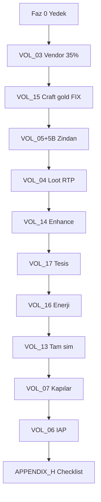

# PLAN 14 — Ekonomi Düzeltme ve Uygulama Planı (Ana İndeks)

> **Durum:** v1.1.0 — Gap taraması sonrası genişletildi (2026-07-21)  
> **Kapsam:** **Tam ekonomi** — musluk, sink, cross-balance, sim gerçekçiliği, monetizasyon, sezon, anti-exploit  
> **Bağımlılıklar:** PLAN_06, PLAN_07 (Mekan köprüsü), PLAN_12, PLAN_13  
> **Sağlamlık checklist:** `APPENDIX_H_ECONOMY_SOLIDITY_CHECKLIST.md`

---

## Belge Seti Yapısı (v1.1)

| Cilt | Dosya | Konu | Öncelik |
|------|-------|------|---------|
| 0 | `00_MASTER_INDEX.md` | Bu dosya | — |
| 1 | `VOL_01_GOVERNANCE.md` | Yönetişim | P0 |
| 2 | `VOL_02_BASELINE_AUDIT.md` | Taban çizgisi | P0 |
| 3 | `VOL_03_VENDOR_SELL_FIX.md` | Satıcı satış %35 | P0 |
| 4 | `VOL_04_LOOT_RTP.md` | Loot Geri Ödeme Oranı | P0 |
| 5 | `VOL_05_DUNGEON_GOLD_CURVE.md` | Zindan Bölge 2–4 | P0 |
| 5B | `VOL_05B_DUNGEON_GOLD_CURVE_Z567.md` | Zindan Bölge 5–7 | P0 |
| 6 | `VOL_06_IAP_FULL_STACK.md` | Uygulama içi satın alma | P0 |
| 7 | `VOL_07_SIMULATION_GATES.md` | Sim kapıları | P0 |
| **13** | **`VOL_13_SIM_FIDELITY.md`** | **Tam sim zorunlu** | **P0** |
| **14** | **`VOL_14_ENHANCEMENT_SINK.md`** | **Enhancement sink** | **P0** |
| **15** | **`VOL_15_CRAFTING_ECONOMY.md`** | **craft_item_async gold bug** | **P0** |
| **16** | **`VOL_16_ENERGY_ECONOMY.md`** | **Enerji gate** | **P0** |
| **17** | **`VOL_17_FACILITIES_ECONOMY.md`** | **Tesis döngüsü** | **P0** |
| **18** | **`VOL_18_SEGMENT_BALANCE.md`** | **Whale/casual** | **P0** |
| 8 | `VOL_08_SEASON_RESET.md` | 365 gün sezon reset | P1 |
| 9 | `VOL_09_MARKET_ECONOMY.md` | Oyuncu pazarı | P1 |
| 10 | `VOL_10_REFERRAL_ANTIABUSE.md` | Referral | P1 |
| 11 | `VOL_11_UI_ECONOMY_UX.md` | Arayüz | P1 |
| **19** | **`VOL_19_GOLD_SINK_REGISTRY.md`** | **Tüm gold OUT** | **P1** |
| **20** | **`VOL_20_GOLD_FAUCET_REGISTRY.md`** | **Tüm gold IN** | **P1** |
| **21** | **`VOL_21_GEM_ECONOMY_REGISTRY.md`** | **Elmas mint/spend** | **P1** |
| **22** | **`VOL_22_HORSE_RACE_ECONOMY.md`** | **At yarışı** | **P1** |
| **23** | **`VOL_23_TRADE_ECONOMY.md`** | **P2P trade** | **P1** |
| **24** | **`VOL_24_HOSPITAL_BANK_GEM_SINKS.md`** | **Hastane/banka** | **P1** |
| **25** | **`VOL_25_CROSS_SYSTEM_BALANCE.md`** | **Cross-balance** | **P2** |
| **26** | **`VOL_26_ANTI_EXPLOIT.md`** | **Rate limit** | **P1** |
| **27** | **`VOL_27_MEKAN_ECONOMY_BRIDGE.md`** | **Mekan/Han** | **P1** |
| 12 | `VOL_12_LIVEOPS_MONITORING.md` | Canlı izleme | P2 |
| A–H | `APPENDIX_*.md` | SQL, test, rollback, PLAN_06 trace, **sağlamlık checklist** | — |

**Alt görevler:** `TASK_INDEX.md` — 119+ görev (genişletiliyor)

---

## v1.0 → v1.1 Eklenen Kritik Boşluklar

| Gap | Risk | Yeni cilt |
|-----|------|-----------|
| Sim side-insert kapalı | Enflasyon kapısı yalan | VOL_13 |
| craft_item_async gold yok | Sink bypass | VOL_15 |
| Enhancement sim'de yok | Item +50% infl. | VOL_14 |
| Bölge 5–7 yok | End-game PLAN drift | VOL_05B |
| Enerji whale bypass | Sınırsız zindan gold | VOL_16 |
| Quest/daily/BP/horse/trade yok | Musluk/sink kör nokta | VOL_19–23 |
| Battle Pass "dokunulmaz" | Gem budget kör | VOL_20 §20.3 |
| Bank UI 50 vs server 5 gem | Güven kaybı | VOL_24 |
| PLAN_06 § trace yok | Tasarım drift | APPENDIX_G |

---

## Uygulama Fazları (Güncellenmiş)

### Faz 0 — Hazırlık
PLAN_12 yedek + VOL_02 taban çizgisi + APPENDIX_H oku

### Faz 1A — Musluk Düzeltme
VOL_03 → VOL_04 → VOL_05 → VOL_05B

### Faz 1B — Sink Düzeltme (KRİTİK)
**VOL_15** (craft gold) → VOL_14 → VOL_17 → VOL_16

### Faz 1C — Sim Doğrulama
**VOL_13** tam sim → VOL_07 kapıları → VOL_18 segment

**Çıkış:** `gold_inflation ≤ 12%` **tam sim ile** + APPENDIX_H B–F

### Faz 2 — Monetizasyon
VOL_06 IAP + VOL_21 gem ledger

### Faz 3 — Sistem Tamamlama
VOL_08–11, VOL_19–27

### Faz 4 — Operasyon
VOL_12 + APPENDIX_H tüm maddeler

---

## Migration Rezervi (Genişletilmiş)

| # | Dosya | Cilt |
|---|-------|------|
| 1 | `20260722_010000_vendor_sell_35_percent.sql` | VOL_03 |
| 2 | `20260722_030000_dungeon_tutorial_farm_penalty_exempt.sql` | VOL_05 |
| 3 | `20260722_020000_dungeon_gold_zone234_multiplier.sql` | VOL_05 |
| 4 | `20260722_150000_dungeon_gold_zone567_multiplier.sql` | VOL_05B |
| 5 | `20260722_040000_loot_rtp_prod_tune.sql` | VOL_04 |
| 6 | **`20260722_130000_craft_item_async_gold_cost.sql`** | **VOL_15** |
| 7 | `20260722_110000_qa_sim_segment_economy_breakdown.sql` | VOL_13 |
| 8 | `20260722_140000_energy_refill_daily_cap.sql` | VOL_16 |
| 9 | `20260722_050000_iap_transactions_table.sql` | VOL_06 |
| 10 | `20260722_060000_verify_and_grant_gems.sql` | VOL_06 |
| 11 | `20260722_070000_market_price_bands.sql` | VOL_09 |
| 12 | `20260722_080000_referral_abuse_limits.sql` | VOL_10 |
| 13 | `20260722_160000_monument_sink_audit.sql` | VOL_19 |
| 14 | `20260722_090000_perform_season_reset.sql` | VOL_08 |
| 15 | `20260722_100000_season_rewards_distribution.sql` | VOL_08 |
| 16 | `20260722_180000_trade_rate_limits.sql` | VOL_26 |
| 17 | `20260722_190000_horse_race_daily_bet_limit.sql` | VOL_22 |

---

## Bağımlılık Grafiği (v1.1)

---

## Hard Gates (Güncellenmiş)

| Kapı | Koşul |
|------|-------|
| G0 | Yedek restore OK |
| G1 | Vendor %35 staging |
| **G1b** | **craft_item_async gold deduct** |
| G2 | Loot RTP 36 kutu OK |
| G3 | Zindan Bölge 2–7 uygulandı |
| **G4** | **Tam sim gold_inflation ≤ 12%** |
| G5 | IAP sandbox OK |
| **G6** | **APPENDIX_H A–G tamam** |

---

## Hızlı Başlangıç

1. `APPENDIX_H_ECONOMY_SOLIDITY_CHECKLIST.md` — hedef listesi
2. `APPENDIX_G_PLAN06_TRACEABILITY.md` — PLAN_06 uyumu
3. Faz 1A → **1B (VOL_15 kritik)** → 1C (tam sim)
4. `TASK_INDEX.md` — alt görevler

---

## Revizyon

| Tarih | Sürüm | Değişiklik |
|-------|-------|------------|
| 2026-07-21 | 1.0.0 | İlk sürüm |
| 2026-07-21 | **1.1.0** | **Gap taraması: +15 cilt, craft bug, sim fidelity, registries, APPENDIX G/H** |
