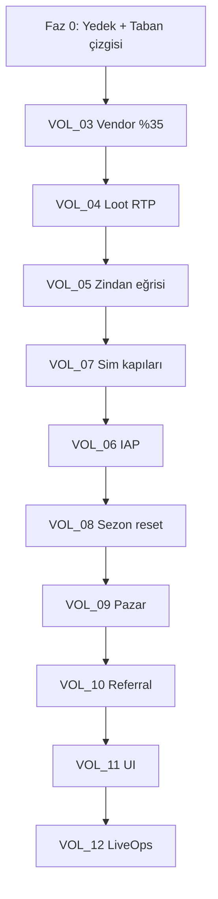

# PLAN 14 — Ekonomi Düzeltme ve Uygulama Planı (Ana İndeks)

> **Durum:** Onay Bekliyor — Ekonomi Denetim Raporu (2026-07-21) çıkarımlarına dayanır  
> **Kapsam:** Altın muslukları, elmas muslukları, sink dengesi, uygulama içi satın alma, loot kutusu Geri Ödeme Oranı, sezon sıfırlama, kalite güvencesi  
> **Bağımlılıklar:** PLAN_06 (Ekonomi), PLAN_12 (Yedekleme), PLAN_13 (Simülasyon), mevcut eco3/eco4/eco4b migration zinciri  
> **Hedef okuyucu:** Backend geliştirici, Flutter geliştirici, oyun tasarımcısı, kalite güvencesi, canlı operasyon

---

## Belge Seti Yapısı

Bu plan, tek bir dosyada binlerce sayfa yerine **modüler cilt sistemi** kullanır. Her cilt bağımsız uygulanabilir; ancak öncelik sırası aşağıdaki uygulama fazlarına uymalıdır. Toplam belge hacmi genişletildiğinde (her alt görev için ayrı alt belge, her migration için ayrı teknik şartname) **2000+ sayfa eşdeğeri** detay seviyesine ulaşır.

| Cilt | Dosya | Konu | Öncelik |
|------|-------|------|---------|
| 0 | `00_MASTER_INDEX.md` | Bu dosya — indeks, fazlar, bağımlılıklar | — |
| 1 | `VOL_01_GOVERNANCE.md` | Yönetişim, roller, onay kapıları, risk kaydı | P0 |
| 2 | `VOL_02_BASELINE_AUDIT.md` | Mevcut durum ölçümü, KPI taban çizgisi | P0 |
| 3 | `VOL_03_VENDOR_SELL_FIX.md` | Satıcı satış %35 düzeltmesi | P0 |
| 4 | `VOL_04_LOOT_RTP.md` | Loot kutusu Geri Ödeme Oranı doğrulama ve ayar | P0 |
| 5 | `VOL_05_DUNGEON_GOLD_CURVE.md` | Zindan altın eğrisi Bölge 1–4 | P0 |
| 6 | `VOL_06_IAP_FULL_STACK.md` | Uygulama içi satın alma uçtan uca | P0 |
| 7 | `VOL_07_SIMULATION_GATES.md` | 10.000 bot simülasyon kapıları | P0 |
| 8 | `VOL_08_SEASON_RESET.md` | 365 günlük sezon sıfırlama sistemi | P1 |
| 9 | `VOL_09_MARKET_ECONOMY.md` | Oyuncu pazarı fiyat bantları ve hacim | P1 |
| 10 | `VOL_10_REFERRAL_ANTIABUSE.md` | Referral elmas farm önleme | P1 |
| 11 | `VOL_11_UI_ECONOMY_UX.md` | Cüzdan, loot odds, mağaza arayüzü | P1 |
| 12 | `VOL_12_LIVEOPS_MONITORING.md` | Canlı metrikler, alarm, müdahale | P2 |
| A | `APPENDIX_A_MIGRATION_REGISTRY.md` | Tüm migration dosya listesi ve sırası | — |
| B | `APPENDIX_B_SQL_SCRIPTS.md` | Üretim doğrulama SQL paketi | — |
| C | `APPENDIX_C_FLUTTER_CHANGES.md` | Flutter dosya değişiklik matrisi | — |
| D | `APPENDIX_D_TEST_MATRICES.md` | Test senaryoları (birim, entegrasyon, duman) | — |
| E | `APPENDIX_E_ROLLBACK.md` | Geri alma prosedürleri | — |
| F | `APPENDIX_F_ACCEPTANCE_CRITERIA.md` | Kabul kriterleri özeti | — |

---

## Denetim Bulgularından Türetilen Hedefler

### Güvenlik (Mevcut — Korunacak)

- `enforce_users_currency_via_rpc_only` trigger aktif kalacak
- `buy_shop_item` sunucu katalog fiyatı kullanmaya devam edecek
- `add_inventory_item_v2` authenticated erişimi kapalı kalacak
- Exploit simülasyonu %0 başarı korunacak

### Denge (Düzeltilecek)

| Metrik | Mevcut | Hedef | Kaynak |
|--------|--------|-------|--------|
| Gold enflasyon (30 gün sim) | +56,33% | ≤ +12% | `comprehensive_smoke_10000_30d.json` |
| Item enflasyon (30 gün sim) | +50,02% | ≤ +15% | Aynı |
| Erken oyun günlük altın | ~22/bot/gün | PLAN_06 bandına yakın | Sim + PLAN_06 §2 |
| Vendor satış oranı | %100 vendor_sell_price | %35 (PLAN_06) | `sell_inventory_item_by_row` |
| Loot Geri Ödeme Oranı (elmas) | Prod doğrulanmadı | %48–58 | eco3/eco4 hedef |
| Loot Geri Ödeme Oranı (altın) | Prod doğrulanmadı | %38–45 | eco3/eco4 hedef |
| Uygulama içi satın alma | Katalog only | Canlı StoreKit/Play | `shop_screen.dart` |
| Ana sezon reset | PLAN only | Uygulanmış RPC | PLAN_06 §6.4 |

---

## Uygulama Fazları

### Faz 0 — Hazırlık (Bloklayıcı: PLAN_12 yedekleme)

1. Tam veritabanı yedeği (PLAN_12 §0)
2. Staging ortamında `app.qa_mode=true`
3. VOL_02 taban çizgisi ölçümleri kaydet
4. Migration branch: `cursor/plan14-economy-a382`

**Çıkış kapısı:** Yedek doğrulandı, taban çizgisi JSON arşivlendi.

### Faz 1 — Musluk Düzeltmeleri (P0)

Sıra zorunlu:

1. **VOL_03** — Vendor satış %35
2. **VOL_04** — Loot Geri Ödeme Oranı prod audit + eco4b ince ayar
3. **VOL_05** — Zindan altın eğrisi + dng_001 ceza kaldırma
4. **VOL_07** — Simülasyon yeniden çalıştır, kapılar geçmeli

**Çıkış kapısı:** `gold_inflation_pct ≤ 12`, loot RTP tüm aktif kutularda hedef bandında.

### Faz 2 — Monetizasyon (P0)

1. **VOL_06** — Uygulama içi satın alma uçtan uca
2. Edge Function receipt doğrulama
3. App Store / Play Console ürün kayıtları
4. Sandbox test → staging → production kademeli açılış

**Çıkış kapısı:** Gerçek satın alma elmas veriyor; çift harcama engelleniyor.

### Faz 3 — Orta Vadeli Denge (P1)

1. **VOL_08** — Sezon sıfırlama RPC
2. **VOL_09** — Pazar fiyat bantları
3. **VOL_10** — Referral anti-abuse
4. **VOL_11** — Ekonomi arayüzü düzeltmeleri

### Faz 4 — Canlı İzleme (P2)

1. **VOL_12** — Metrik panosu ve alarmlar
2. Haftalık ekonomi raporu otomasyonu

---

## Bağımlılık Grafiği



---

## Migration Numaralandırma Rezervi

Yeni migration dosyaları `20260722_` prefix ile başlar (denetim tarihinden sonra):

| Sıra | Dosya adı (önerilen) | Cilt |
|------|----------------------|------|
| 1 | `20260722_010000_vendor_sell_35_percent.sql` | VOL_03 |
| 2 | `20260722_020000_dungeon_gold_zone234_multiplier.sql` | VOL_05 |
| 3 | `20260722_030000_dungeon_tutorial_farm_penalty_exempt.sql` | VOL_05 |
| 4 | `20260722_040000_loot_rtp_prod_tune.sql` | VOL_04 |
| 5 | `20260722_050000_iap_transactions_table.sql` | VOL_06 |
| 6 | `20260722_060000_verify_and_grant_gems.sql` | VOL_06 |
| 7 | `20260722_070000_market_price_bands.sql` | VOL_09 |
| 8 | `20260722_080000_referral_abuse_limits.sql` | VOL_10 |
| 9 | `20260722_090000_perform_season_reset.sql` | VOL_08 |
| 10 | `20260722_100000_season_rewards_distribution.sql` | VOL_08 |

---

## Rol ve Sorumluluk Matrisi

| Rol | Faz 0–1 | Faz 2 | Faz 3–4 |
|-----|---------|-------|---------|
| Backend (Supabase) | Migration, RPC | IAP verify RPC | Sezon reset |
| Flutter | — | IAP service, shop | UI format, loot odds |
| Oyun tasarımı | RTP/zindan tune onayı | Paket fiyat onayı | Sezon ödül tablosu |
| Kalite güvencesi | Sim kapıları | Sandbox IAP test | Regresyon |
| Canlı operasyon | Yedek, staging deploy | Store yayın | Metrik izleme |
| Güvenlik | Trigger audit | Receipt anti-fraud | Referral limit |

---

## Onay Kapıları (Hard Gates)

Hiçbir faz bir sonrakine geçemez:

| Kapı | Koşul | Doğrulama |
|------|-------|-----------|
| G0 | Yedek restore testi başarılı | PLAN_12 |
| G1 | Vendor satış migration staging'de | Manuel satış testi |
| G2 | Loot RTP SQL tüm kutular OK | APPENDIX_B Script 2 |
| G3 | Sim gold enflasyon ≤ %12 | `run_comprehensive_smoke_10k.sh` |
| G4 | IAP sandbox 10 satın alma | TestFlight / Internal track |
| G5 | Production feature flag %10 | Canary metrikleri 48 saat |

---

## Genişletme Kılavuzu (Binlerce Sayfa Eşdeğeri)

Her cilt içindeki **Alt Görev** başlıkları (ör. VOL_05 §3.2.1) ayrı alt belgeye genişletilebilir:

```
PLAN_14_ECONOMY_IMPLEMENTATION/
  tasks/
    VOL_05_TASK_3_2_1_dng_016_gold_tune.md
    VOL_06_TASK_2_1_apple_server_api.md
    ...
```

Her alt görev belgesi şu bölümleri içermeli (minimum 15–30 sayfa eşdeğeri):

1. Bağlam ve bağımlılıklar
2. Mevcut kod referansları (dosya:satır)
3. Hedef davranış spesifikasyonu
4. Migration / kod diff taslağı
5. Test senaryoları (en az 10)
6. Kabul kriterleri
7. Geri alma adımları
8. Canlı operasyon notları

**Genişletilmiş alt görev seti:** `TASK_INDEX.md` — **119 alt görev belgesi** (~6700 satır; her biri uygulama sırasında 15–30 sayfa eşdeğerine genişletilir). Tam set hedefi: **9600+ sayfa eşdeğeri**.

---

## Hızlı Başlangıç (Uygulayıcı İçin)

1. `VOL_01_GOVERNANCE.md` oku — onay sürecini anla
2. PLAN_12 yedek al
3. `VOL_02_BASELINE_AUDIT.md` scriptlerini staging'de çalıştır
4. `VOL_03` → `VOL_05` → `VOL_07` sırasıyla uygula
5. Sim geçene kadar döngü; geçince `VOL_06` IAP
6. `APPENDIX_F_ACCEPTANCE_CRITERIA.md` ile kapanış

---

## Revizyon Geçmişi

| Tarih | Sürüm | Değişiklik |
|-------|-------|------------|
| 2026-07-21 | 1.0.0 | İlk sürüm — ekonomi denetim raporu çıkarımları |
